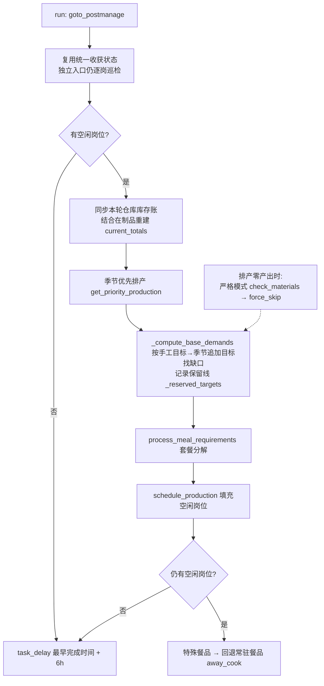
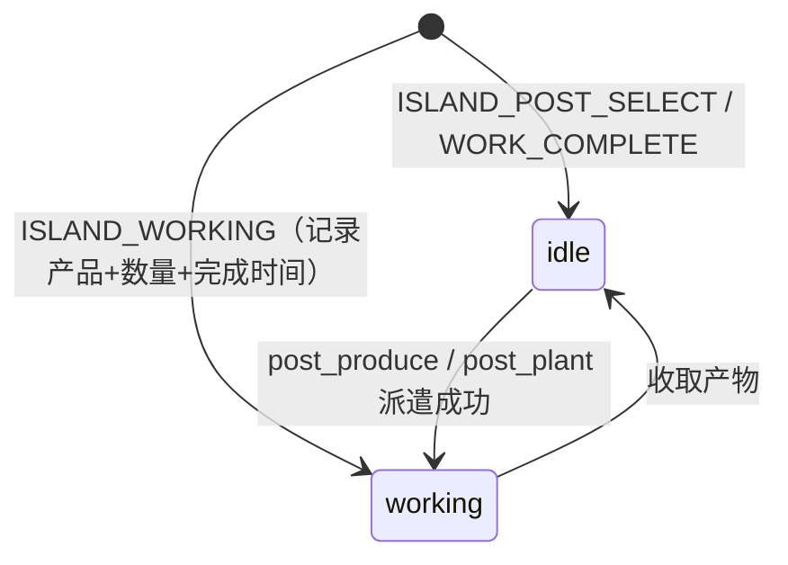

# 岛屿系统（module/island）

> 碧蓝航线「离岛」生活玩法的自动化：四大生产区派遣、六类店铺生产、商区经营与每日/每周任务（采集、订单、空投、互动、货运、珍珠交易）。

## 1. 模块概述

离岛是游戏内的常驻生活玩法：玩家在岛上经营农田、果园、苗圃、牧场、渔场、矿山、林场，把产出加工成菜品饮品，再通过岗位派遣、商区经营、货运委托与珍珠交易换取资源。玩法画面是自由视角的 3D 岛屿（长按移动视角），内部大量同构 UI（岗位详情、产品选择、角色选择、购买弹窗）在十几个子玩法间重复出现。

本模块把这些玩法拆成一个厚基类 `Island` 加约 20 个任务类：基类负责所有子玩法共享的「岛屿导航、岗位管理、产品/角色选择、仓库筛选与 OCR、商店补货」原语；每个任务类只描述自己玩法的岗位布局、产品配置和调度规则。店铺类玩法（餐馆、饮品、烧烤、简餐、咖啡、制造业）再共享一层 `IslandShopBase`，统一「库存 → 需求 → 套餐分解 → 排产」的算法。另一个贯穿全局的维度是**季节**：全局配置 `IslandPlan.Season` 决定四季限定物品是否参与补种与生产，由 `island_season.py` 统一管理。

调度上，`alas.py` 尾部的 `island_*` 任务方法惰性导入对应模块；任务之间有一条显式联动链：牧场任务执行完后内联执行渔场任务并合并两者计时器，商区经营开始后会触发对应餐馆类生产任务。

### 手工生产的单轮流程

原调度器首次选中一个生产任务，由 `production_round.py` 建立本轮上下文，执行「统一收获 → 返回管理页 → 仓库按产地集中盘点 → 返回岗位管理 → 按手工目标派遣」。保留手工目标、岗位和角色设置。独立规划器仅在工具页主动运行；`IslandPlan` 继续负责季节与走位校验，不再承载运行时自动规划。

- **统一收获**：各模块的 `prepare_round()` 巡检全部已定义岗位，包括配置关闭的岗位；仅领取已有产物，不撤回工作中岗位。点击领取后须识别奖励并关闭，再确认岗位状态；连续奖励之间的暗色或蓝白动画仍可能匹配背景岗位图案，须同时通过模板和正常颜色确认，才能累计就绪时间。奖励标题使用二维偏移定位，额外奖励继续在同一收获循环中处理；列表和详情使用相同的完成确认，不能因底层页面露出而提前退出。关闭的岗位不会被新增派遣。岗位状态和在制数量保留在该模块实例中，正式执行时不再次收获。
- **仓库按产地集中盘点**：统一收获后合并本轮待执行任务需要的成品和材料，`round_warehouse.py` 按筛选组去重读取仓库当前列表；同一筛选组只读取一次，不滑动或扫描全仓，不点击物品详情，也不借空岗或角色进入生产页查库存。四种饲料、面粉、两种鱼肉和新鲜蜂蜜合并使用“产地 → 其他”，不再单独筛选“分类 → 加工品”；牧场独立入口也读取同一份产地映射。物品通过完整品名或已有图标定位，数量从同格数字批读。完整确认筛选列表后，缺项可以记为零；列表未完整显示、未知卡片或数量识别失败时，不把缺项推断为零。没有明确筛选映射的必要材料保留未知，补齐映射后再读取。
- **按原任务执行**：保留任务优先级、手工目标、默认产品和角色配置。已收获成为空岗的启用任务进入原调度队列，各任务独立记录结果与下次时间；渔场仍由牧场执行一次并合并计时器。农田、牧场在共享轮中直接复用库存并进入岗位管理，不先绕回岛屿场景再进入管理页；独立执行仍保留原入岛流程。整点/半小时对齐继续使用原 `TaskAlignment`，不会创建第二个并行生产轮次。
- **按需补料与快速派遣**：食品和制造先按仓库账、完整配方及手工保留线裁剪安全批次，已有模板使用原选品与快速加号；缺模板配方保留已有完整名称选择及定量兜底，但不借此读取库存。共享轮下单前必须连续两帧确认实际次数不超过裁后的上限，未知或超量不提交。种子、鱼苗在原任务内按需补买；饲料和面粉在牧场内部按原磨坊流程补充，保留这些交易和材料数量页必要的即时确认。没有全岛集中采购阶段；采购已成功而派遣失败时，已买到的材料仍保留为现货。
- **指定原料沿用按钮判断**：花生、春笋、荠菜原料，以及冬菇、马蹄、梅花、水仙花没有已确认的仓库产地映射，不纳入原料盘点；数量未知时由实际生产页的按钮灰态判断是否可生产，相关成品仍照常盘点。没有数字证据时不伪造库存或扣料余额；已有明确数量（含零）时仍按库存限制批次，同一配方其他已知材料按确认后的实际批次扣减。按钮灰色则屏蔽该产品的本轮重试；界面允许的次数少于计划时，确认后复检岗位实际数量。例外仅适用于上述七项，其他原料或目标成品库存未知仍阻止相关派遣。煤炭使用“沉石矿山”产地，两种鱼肉使用“其他”产地。
- **共享扣料**：`round_inventory.py` 只保存本轮现货、在制产物与失败产品。食品和制造按完整配方、实际批次扣料；种苗与牧场按选品页实际总需求扣料；磨坊和鱼肉兑换同时扣原料、加到账产物。派遣产物只计入在制，领取前不得作为后续原料。零材料直接跳过，未知库存不作为零或充足使用；套餐分解不会重新派遣本轮已确认失败的产品。
- **优先任务插队后续接**：委托、科研等不改变岛屽物资的任务按原优先级在任务边界执行，本轮实例、仓库库存账和剩余任务保留；返回后继续未完成任务，不重复统一收获或重读仓库，也不因跨过下一个整点而丢弃。期间生产完工但尚未收取的产物仍不计入现货。
- **失效与恢复**：实际执行订单、经营、货运等其他岛屿玩法，游戏重启、确认结果不明的异常或生产相关配置改变会结束旧库存上下文，随后重新确认实际状态。配置签名保留九个生产任务、全局与季节目标、经营菜单和季节订单保留量依赖，忽略各任务 `Storage`、`Scheduler.NextRun`；仅保存无关采集、补给、货运或独立规划器设置不使生产轮失效。重建或丢弃时记录原因，配置变化最多输出八个参数路径，不输出取值。退出进程不保存库存账。完成全部本轮任务后丢弃上下文，下一轮重新收获盘点。真实配置保存重载、跨整点及任务边界回归见 `tests/test_island_round_lifecycle.py`。
- **共享准备与鱼肉确认失败**：统一收获或仓库准备发生页面无法确认、卡死或重复点击异常时，按当前入口的 `Scheduler.FailureInterval` 和岛屿时间对齐规则，延后所有已启用生产任务及当前入口；保留原本更晚的排期和任务开关，异常继续交原恢复流程处理。派遣阶段收到专用 `IslandFishExchangeError` 时也先丢弃共享库存，再执行相同整组延期，避免确认结果未知后反复复用旧账或由其他生产入口立即重新尝试；冷却结束后重新收获盘点。该异常仍继承 `GameStuckError` 并原样上抛，保留原有一次现场保存与安全恢复，不把失败记成成功。同一进程中的游戏重启、自定义调度卡片及其他任务成功清零全局错误计数，均不能绕过该岛屿冷却；委托、科研及恢复入口仍可运行。主动停止、游戏未运行和其他普通派遣异常保持原规则，不额外扩大整组延期。专项延期回归见 `tests/test_island_fish_exchange_retry.py`。

调度器的停止、维护、重启和单任务结果边界仍然保留；单轮协调器不直接串行调用所有任务的 `run()`，也不把尚未执行的任务记为成功。离线验证入口为 `tests/test_island_production_round.py`、`tests/test_island_round_*.py` 及已有岛屿回归测试，覆盖真实仓库列表、空仓、当前页读取、库存复用、快速派遣及未知读数保护。

国服统一收获按 `post_list.CN_POST_ROWS` 已核实的列表行序执行：农田／牧场、渔场／矿山、林场／果园、苗圃／餐馆、白熊饮品／简餐、烤肉／木料加工、工业／电子加工、手工／咖啡。各模块以 `prepare_round_start()` 初始化记录、`prepare_round_post()` 复用原单岗收获与状态确认、`prepare_round_finish()` 汇总，避免按模块收完下方岗位后再回上方。所有已定义岗位仍巡检一次，停用岗位只收获；途中逐岗检查停止请求，全部收获成功后才盘点一次。渔场继续由牧场持有，不能被重复初始化或收获。其他服务器及独立模块入口保留原收获顺序，实际生产任务优先级不随收获路线改变。

连续岛屿任务保留已经加载的本地 OCR 模型，减少逐模块释放和重新初始化；切换到其他任务、空闲或更换服务器仍按原释放策略处理。该缓存仅涉及识别模型，仓库库存和识别结果仍遵循本轮账的独立生命周期。

## 2. 模块职责

### 负责

- 岛屿页面导航与地图移动：进入管理/岗位管理/仓库/好友岛页面，岛屿地图目的地跳转（矿山林场、农场、苗圃、集会、港口），长按视角移动（`island_up/down/left/right`）。
- 岗位管理原语：遍历岗位、打开/关闭岗位详情、收取产物、追加派遣、页签切换（生产/经营/采集）。
- 派遣两要素：角色选择（网格识别 + 体力 OCR + 优先级回退）与产品选择（模板匹配 + 滑动搜索 + 材料数量 OCR + 商店即时补货）。
- 仓库能力：种类/来源双维度筛选，网格模板匹配 + 数字 OCR 读库存。
- 各生产玩法（农田/果园/苗圃、牧场+磨坊、渔场、矿山林场）与六类店铺（烧烤、白熊饮品、有鱼餐馆、啾啾简餐、啾咖啡、制造工坊）的自动运营。
- 商区经营（5 家商店的按钮状态机、季节/加成商品替换、分批经营）。
- 每日每周任务：采集派遣、每日订单与紧急委托、空投与好友岛补给、摸猫/速运/外送/每周照相、货物筹备运输、珍珠每周采购售卖。

### 不负责

- 季节数据的提取（`dev_tools/island_extractor.py` 是独立开发工具，运行时不参与）。
- 岛屿商店金币/货币的 Dashboard 上报、常规游戏商店（`module/shop`）。
- 页面跳转图谱本身的维护（`module/ui`，本模块只新增岛屿页面节点）。
- 调度恢复与异常重试策略（`module/runtime`，本模块只通过 `task_delay` 与异常语义对接）。

## 3. 模块位置

```
module/island/                  # 全部逻辑所在的主包
├── island.py                   # Island 基类：导航、岗位、选品、仓库筛选、商店购买
├── island_select_character.py  # SelectCharacter：角色网格识别、体力、滚动查找
├── warehouse.py                # WarehouseOCR：仓库网格模板定位 + 数量 OCR
├── production_round.py / round_inventory.py / round_warehouse.py  # 手工单轮协调、共享库存、仓库产地盘点
├── island_shop_base.py         # IslandShopBase：店铺通用排产框架
├── island_season.py            # SeasonConfig：季节常量与全局单例
├── ui.py                       # IslandUI：运输/管理页导航，岛屿弹窗处理
├── assets.py                   # button_extract 生成的公共岛屿按钮
├── island_farm.py / island_rancher.py / island_fishery.py / island_mine_forest.py
├── island_grill.py / island_teahouse.py / island_restaurant.py
├── island_juu_coffee.py / island_juu_eatery.py / island_manufacture.py
├── island_business.py          # 商区经营（最大的单文件，含按钮状态机与批次逻辑）
├── island_daily_gather.py / island_daily_interact.py / island_daily_order.py
├── order.py / order_detail.py / order_quota.py / order_ocr.py / order_selection.py / order_stock.py
├── data.py / item_ids.py / winter_extension.py
├── technology_scanner.py / manufacture_catalog.py / manufacture_selector.py
├── recipe_groups.py            # 统一历季配方场所，不把场所映射当作科技解锁
├── production_recipe.py / raw_catalog.py / shop_selector.py / fish_exchange.py
├── stock_probe.py              # 无旧模板副产物的仓库详情现货观测
├── island_air_drop.py / island_pearl_sell.py / island_cargo_preparation.py
└── 各生产模块的 prepare_round / round_stock_items / run 共同组成单轮阶段

module/island_farm/ 等 16 个目录  # 薄壳：仅 button_extract 生成的 assets.py

module/island_planner/          # 岛屿生产规划器（工具页任务，移植自 ALAS），只写配置不做生产
├── data.py / utils.py / restaurant_config.py / calculator.py   # ALAS 原样移植的数据表与线性规划
├── settings_map.py             # 规划结果 → AzurPilot 配置（菜品/作物名与物品 ID 对照）
├── scanner.py                  # 岛屿科技树扫描
└── planner.py                  # IslandProductionPlanner 任务入口
```

**薄壳目录设计**（本模块最容易误解的结构）：`dev_tools/button_extract.py` 扫描 `assets/{cn,en,jp,tw}/` 下所有子目录，为每个目录机械生成同名 `module/<目录>/assets.py`。岛屿团队把按钮截图按子玩法拆到了 `assets/cn/island_farm/`、`assets/cn/island_restaurant/` 等 16 个目录（每个玩法几十到上百个 `POST_XXX`/`SELECT_XXX`/`TEMPLATE_XXX` 资源），生成器便机械地产出了 16 个只含 `assets.py` 的「薄壳」目录。这些薄壳**不承载任何逻辑，也没有被 alas.py 导入**——`alas.py` 的 17 个 `island_*` 任务方法全部 `from module.island.island_xxx import Xxx`（主包），薄壳只作为资源文件被主包逻辑 `from module.island_farm.assets import *` 反向引用。其真实价值是**资源隔离**：单一 `island/` 资产目录已超百个文件，按玩法拆分让模板/按钮按玩法成组维护，跨玩法复用（如牧场复用农田的作物模板、渔场复用牧场的按钮）直接 import 对方薄壳即可。`island_fishery.py` 中「重新导入鱼苗商店专用按钮（覆盖 island.assets 中的同名旧定义）」的注释佐证了资源在逐步从 `island/` 迁出到玩法目录，旧同名定义靠后置 import 覆盖。

## 4. 核心入口

| 入口 | 用途 |
| --- | --- |
| `alas.py` 的 `island_farm`/`island_rancher`/`island_fishery`/`island_mine_forest` 等方法 | 调度器按任务名进入各玩法，惰性导入并 `run()` |
| `IslandShopBase.run()` | 六类店铺（含制造业覆盖版）的统一生产主流程 |
| `IslandBusiness.run()` | 商区经营状态机（分批/传统两种模式） |
| `IslandDailyGather/Interact/Order/AirDrop/PearlSell.run()` | 每日每周任务的独立入口 |
| `IslandOrder.run()` | 普通／紧急／季节订单，实际 `island_daily_order` 调度入口；旧类保留兼容原语 |
| `IslandProductionPlanner.run()` / `refresh_production_plan()` | 季节缺货和生产任务入口触发科技、岗位、配方与菜单规划 |
| `IslandCargoPreparation.run()` | 货运委托入口（唯一基于 `IslandUI` 而非 `Island` 的主流程） |
| `Island`（基类本身） | 无 `run()`，不作为任务运行；alas 的 `island()` 方法仅为导入基类存在 |
| `tests/test_island_shop_production.py` | 离线验证店铺排产逻辑（假 UI，不连游戏） |

## 5. 核心组件

| 组件 | 基类 | 职责 |
| --- | --- | --- |
| `Island` | `SelectCharacter` | 岛屿全局基类：`goto_management`/`goto_postmanage`/`island_map_goto`、岗位详情状态机（`post_open`/`post_get_and_add`/`confirm_post_add_order`）、`select_product`（滑动选品）、材料 OCR 与商店补货（`ensure_select_product_material`）、`warehouse_filter`、`buy_shop_item` |
| `SelectCharacter` | `UI` | 角色网格（前两行）身份/工作/选中状态识别；仅派工作啾时不打开筛选，直接确认当前工作速度升序，在当前页识别空闲工作啾并复核选中状态，免体力 OCR |
| `WarehouseOCR` | — | 6x2 仓库网格上按模板定位物品并 OCR 数量（`ocr_item_quantity`） |
| `IslandShopBase` | `Island, WarehouseOCR` | 店铺框架：`Meal1~8` 槽位需求、套餐分解、保留线排产、循环填岗 |
| `IslandUI` | `UI` | 岛屿手机页的运输/管理入口，覆盖 `ui_additional` 处理维护公告与信息弹窗 |
| `SeasonConfig` | — | 读取 `IslandPlan.Season`，提供按模块键查询当季限定物品；进程级单例 |
| `CargoPreparationTransport` | — | 单个货运栏位的解析模型（状态/货物/时长） |

各任务类一览（玩法见第 6 节）：

| 任务类 | 组合的父类 | 玩法 |
| --- | --- | --- |
| `IslandFarm` | Island + WarehouseOCR + LoginHandler | 农田/果园/苗圃补种 |
| `IslandRancher` | 同上 | 磨坊加工 + 牧场养殖，完成后串联渔场 |
| `IslandFishery` | 同上 | 鱼苗购买与养殖，合并牧场计时器 |
| `IslandMineForest` | Island + LoginHandler | 矿山/林场派遣 |
| `IslandGrill/Teahouse/Restaurant/JuuCoffee/JuuEatery` | IslandShopBase | 餐饮店铺生产 |
| `IslandManufacture` | IslandShopBase（重度覆盖） | 工坊四产线 |
| `IslandBusiness` | Island | 商区经营 |
| `IslandDailyGather/Interact/Order/AirDrop/PearlSell` | Island | 每日每周玩法 |
| `IslandCargoPreparation` | IslandUI | 货运委托 |

## 6. 工作流程

### 岛屿管理与手机入口就绪确认

从岛屿主场景进入管理或手机页前，共享 UI 导航通过 `UI.ui_island_entry_ready()` 持续截图确认 `ISLAND_CHECK`，并要求目标入口的模板与颜色同时匹配、连续可见至少 1 秒且覆盖至少 3 帧，之后才点击。独立 `Island.goto_management()` 继续通过 `UI.ui_island_management_entry_ready()` 复用相同检测。按当前服务器资源识别：CN／JP／TW 使用各自入口，EN 的右上入口直接使用 `ISLAND_CHECK`，不强制匹配 CN 图案。仅出现岛屿页面特征不能证明场景转场已结束；入口消失、页面变化或弹窗处理后重新累计稳定状态，不跨导航缓存，不用固定休眠猜测就绪。

点击后仍以目标页特征正向确认成功；独立管理入口保留默认 3 秒的可配置补点间隔，通用 `ui_goto()` 保留 5 秒导航点击间隔。就绪检测不放宽超时和设备卡死保护；长期无法进入时沿原异常或导航恢复流程处理。

普通 `Island` 任务不继承 `IslandUI`，因此通过自己的 `ui_additional()` 复用 `ISLAND_INFO_EXIT` 信息弹窗模板，关闭开发季提醒等已识别信息。关闭间隔为 3 秒，只有实际点击才返回已处理；弹窗冷却时不继续调用通用弹窗处理器。独立管理导航先检查信息提示和领取奖励，再确认目标页或管理入口；关闭后从新截图重新确认就绪。已在岛屿页的通用导航继续要求管理入口的颜色与模板同时匹配，信息弹窗后的暗色背景不能作为可点击入口。

离线回归入口：[管理页导航](../../../tests/test_island_goto_management.py)、[共享入口就绪与通用导航](../../../tests/test_ui_island_management_entry.py)、[信息与奖励遮挡导航](../../../tests/test_island_navigation_popups.py)。

### 生产派遣的公共骨架

各任务共用岗位导航、角色选择和派遣确认。共享轮先统一收获，再按以下顺序执行；独立调用保留原入口。

| 任务 | 巡检、库存与排产顺序 |
| --- | --- |
| 农田／果园／苗圃 | 同步集中仓库账，按目标安排补种；种子在当前任务内按需补买 |
| 矿山／林场、渔场 | 按集中仓库账和在制数量计算缺口；矿林保留已设置的生产次数，鱼苗在渔场任务内补买 |
| 食品店铺、制造工坊 | 按集中仓库账计算需求和材料上限，再使用原选品与快速加量；下单前确认实际次数，无空岗时跳过新生产安排 |
| 手工牧场 | 同步仓库中的主副产物、农产品及磨坊库存，再按需加工、追加或派遣 |
| 规划牧场 | 逐岗巡检领取并记录状态，空岗继续按主副产物需求或余岗积累计划派遣 |

进入岛屿后，通过 `goto_postmanage()` 和 `post_manage_mode()` 选择岗位列表。`post_locate()` 与 `post_open()` 共用具体岗位定位：先在当前帧目标所在列的完整列表高度匹配类别标题，导航使用固定 0.85 阈值，不随高分辨率全局阈值降至 0.75；标题通过且整张岗位卡完整可见时可以打开详情，不预先滑动。国服目标不可见时，按当前可靠可见的类别判断前后方向，有界补滑；标题可见但卡片贴边时只补足所需距离，滑动后持续截图，确认连续两帧坐标稳定才使用。方向无法确认或当前方向搜索达到上限时，才有限回顶并搜索；非国服不套用国服类别顺序，目标不可见时沿用有界回顶搜索。搜索及重新进入管理页均保留次数和超时上限。

各生产任务的统一收获、正式派遣和磨坊回岗取消固定回顶、固定下滑次数及苗圃至少滑动一次等预定位，直接交给具体岗位入口；选品、货架及磨坊内部滑动保持原流程。领取巡检先执行下述空岗预检；其余岗位仍用 `post_open()` 打开详情，收取已完成产物，记录工作中岗位的产品、数量和 `Duration` OCR 剩余时间。能收取阶段产物的工作中岗位在领取后继续复查，不能因收取就认定已经空闲。本次定位不新增配置，不改变仓库按产地读取当前页的流程。定位回归见 `tests/test_island_post_navigation.py`。

生产、经营和采集页签切换优先处理已识别的经营事件与领取奖励。经营事件（美食评审、健康开发日等）沿 ALAS 的两阶段流程：识别事件徽标后点击底部空白展开详情，再识别详情的关闭按钮后关闭；点击冷却期间仍阻止后台页签操作，不以页签不可见猜测弹窗。未知画面保留超时恢复。回归见 `tests/test_island_business_event.py`。页签切换关闭已识别的领取奖励，奖励仍在关闭冷却时继续截图，不能点击其后的页签或把背景目标页签当作切换成功。奖励关闭后的新帧须正向确认目标页签；原 15 秒切换超时保持不变。

新派遣通常按「打开空岗 → 委派 → 角色选择并确认 → 商品选择及材料检查 → 设置次数 → 确认」执行。种子、鱼苗等不足时由对应补货流程处理，数量按任务需求、材料和岗位上限决定，不统一假设都点最大。派遣成功后取得完成时间；餐饮可使用可靠预览省去回岗复检，其他路径继续实读岗位。全部安排完成后，将有效未来完成时间与约六小时复查候选交给 `task_delay()`，再应用全局岛屿时间对齐；牧场将计时器传给渔场统一调度。农田、牧场本轮已有计划的空岗未能完成派遣时，另加入五分钟后的复查候选，与有效完工时间取较早者再对齐，不因其他岗位已安排成功而把失败空岗延后数小时。这里不使用单位为分钟、默认值为 120 的 `Scheduler.FailureInterval`；例如 07:48 失败时五分钟候选为 07:53，整点对齐后为 08:00。临近整点时五分钟候选可能跨过该边界，仍按原规则向后对齐。

餐品与制造工坊巡检非空岗位时，先用 `post_get_stay()` 确认收获结束并停留详情，再由 `refresh_post_occupation()` 在五秒内用新截图重新确认占用、剩余数量和时间，最后关闭详情。`ISLAND_WORK_COMPLETE` 或可领取按钮只说明有批次可收获，不能证明整个队列结束；例如领取两份后仍有四份豆腐时，岗位仍为 `working`。只有正向识别可委派或空岗才记 `idle`；既无法确认工作也无法确认空闲时记 `unknown`，本轮不向该岗位派遣，季节目标继续按在制身份未知的规则暂停补量。

工作时长原始文本须完整时分秒且大于零，截断或噪声不当作零秒完成。时长仍未知但已确认工作时保留商品和数量；同岗每次复核替换其旧在制贡献，保留其他岗位的贡献，不在重读循环中重复累计。本轮刚确认派遣且已记入共享账的产物，后续复核也不再次记为旧在制品。执行到该模块任务收尾时，未知工作时长或收获后状态未知加入五分钟复查候选，与已知完工时间取早后沿现有对齐；仅被统一巡检但本轮不执行的任务不因此插队。制造工坊按全岗时间映射核验，含已禁用但仍工作岗位。回归见 `tests/test_island_shop_working_duration.py` 和 `tests/test_island_partial_harvest.py`。

实际派遣入口优先处理奖励遮挡，识别到工作中详情或追加生产按钮时保留当前队列，复核占用并正向关闭岗位，返回“岗位忙”结果。这不是材料或角色不足，不扣库存、不将拟生产商品记入本轮不可用集合。食品排产遇到此结果先结束当前排产批次，由外层使用新发现的在制数量重算缺口，再继续其他空岗；例如目标豆腐十份、发现原岗位还有四份，另一空岗只补六份，旧四份不计作本轮新增。制造同样保留商品供其他空岗继续尝试；关闭或状态确认异常仍交现有恢复机制。匿名错误帧回放只保留岗位商品、次数、计时及追加按钮区域，用于确认在产页可直接识别，不代替真实收获与派遣验收。

共用模板选品 `select_product()` 先确认目标选中状态，已选中或点击后下一帧就绪时立即返回。点击后留出两秒确认窗口，只有新帧仍识别到目标才补点，最多三次实际点击；选中图暂时消失不再触发滑动。搜索时必须正向确认选品页，最多八次实际滑动，最后一次滑动后仍复检目标；滑动与惯性停止之间保留 0.3 秒、停止后保留 0.2 秒，由同一截图循环计时，不固定休眠。页面未知只等待，全流程三十秒后返回失败并由调用方恢复，不提交派遣；原选品模板阈值、快速调量及库存保护保持。回归见 `tests/test_island_select_product_state.py`，其中青枣粥状态序列由国服资源构造，未代替实机验收。

选品页材料计数按完整灰底标签动态定位，随标签横移调整读取范围；同时保留白色数字与橙色加项，避免固定裁切漏掉首尾或仅提取白字低估耗料。两种亮度阈值的识别结果一致后，仍须通过完整“现有数量／需求数量”校验：例如 `62/(2+6)` 的总需求为 8，`62/(10+30)` 为 40。纯数字、缺失任一侧或不完整表达式不当作有效计数，标签截断、缺失或不唯一也保留未知。农田、牧场首次读数不完整时，在原状态循环内最多读取三帧，仍无法确认才跳过本次补货与派遣；不能把未知当零、把相连数字自行拆成分数，或仅凭购买目标推算实际库存。补货检查和确认前扣料共用该完整计数，实际次数与总耗料仍须连续两帧一致才提交。匿名实屏回归见 `tests/test_island_material_counter_image.py`。

种子／鱼苗补货目标为尽力补齐：付款只确认一次，连续等待三秒且至少六帧仍停在购买数量页时，关闭购买弹窗并正向确认回到商店，返回选品页重新读库存。本轮记住该材料失败的最小购买量，现货够页面单次需求则直接派遣；不足时只尝试更少的实际缺口，再失败则跳过岗位。成功奖励和其点击冷却优先于背景页面，原手工数量、批次上限及库存复核保留。磨坊加工不套用岛币不足推断，保持原有确认补点与返回保护。

牧场补料继续优先使用空岗的材料快捷入口：先复用本轮岗位状态排除明确工作中或未开放的岗位；已确认空岗优先选择当前画面完整可见者，未知状态仍沿原有界检查。没有共享状态的独立入口保留原检查。快捷入口均不可用时，先确认回到岗位管理，再由 `goto_mill()` 返回本岛、点击商店并选择磨坊，不再传送农场或移动角色找 NPC。商店侧栏按官方完整名称定位，适应展开子菜单导致的位置变化；磨坊标题和橙色加工标签同时确认、稳定至少半秒且三帧后才加工，残留标题、弹窗和未知页不能算成功。入口三十秒超时后返回岗位管理并跳过本轮补充，回岗失败或导航异常仍交原恢复处理。原补料项目、数量、材料保护及加工后返回流程保持；回归见 `tests/test_island_ranch_mill_fallback.py` 和 `tests/test_island_mill_shop.py`。

本岛地图入口必须同时确认本岛场景和地图按钮图案、颜色，不能用岗位管理页同位置的浅色背景代替。已知岗位管理、管理、仓库页沿既有 `Page` 导航返回本岛；原标题不能确认岗位页时，仅在生产页签与返回箭头同时通过模板和颜色检查、详情已关闭的情况下，沿原链接返回管理页。返回后的过渡帧持续等待，确认管理页后才继续通用导航；好友岛路径保留自己的入口。地图循环优先处理弹窗，可见且仍在关闭冷却中的弹窗继续阻止背景导航；入口点击后用新截图确认地图页面，补点共用三秒冷却并保留原超时和设备点击保护。实拍误识别回放与导航状态循环回归见 `tests/test_island_map_entry.py`，合成导航状态不代表真实游戏验收。农田、矿林、渔场的新派遣仍回岗位实读时间；尚未验证这些页面的预览时长语义，不套用食品预览快路径。

### 岗位领取与补货状态确认

岗位领取、停留、关闭及追加派遣共用新截图状态循环：可见奖励优先于背景岗位或列表，`handle_island_reward_popup()` 只在实际点击安全区后返回 `True`，同一奖励的补点间隔为 2 秒；冷却期间仍截图观察，不点击背景。实际首次领取后清除上一笔奖励的冷却，不拖慢新的领取。奖励消失后，以岗位空闲、可委派、在产或完整列表等正向状态稳定至少 0.5 秒、覆盖至少 3 帧确认继续；迟到奖励清空稳定计时，不再固定等待后盲点两次安全区。关闭详情后用下一帧确认列表再结束；角色筛选残留、错误弹窗和超时沿原恢复路径处理。

种子、鱼苗及磨坊加工复用 `confirm_island_shop_purchase()`：数量页确认付款、成功框关闭、商店恢复分别识别。付款与关闭成功框是两个合法动作；同一成功框的购买尾部与返回流程共用 2 秒冷却，已看到成功框后数量页重绘也不再付款。首次实际付款清除上一笔成功框的冷却，新交易可以立即关闭新成功框。看到成功框或实际发送付款后，商店正向状态稳定至少 0.5 秒、覆盖至少 3 帧才结束，兼容截图未采到短暂成功框；只看到商店、按钮消失或未知页面均不能算购买成功。数量和材料判断保持原策略。

商店页签切换先连续确认商店和目标入口至少 0.3 秒、覆盖至少 3 帧，再首次点击；补点间隔为 2 秒，目标选中即结束。岗位选品页进入补货时，只在正向确认选品页后点击材料卡片，再由新截图识别真正的「前往购买」入口，不使用未识别入口的兜底点击。鱼苗「其他」页签与种苗商店共用此规则。

离线回归入口：[奖励与商店状态](../../../tests/test_island_reward_state.py)、[磨坊付款及成功框](../../../tests/test_island_mill_confirm.py)、[牧场阶段收取](../../../tests/test_island_ranch_planner_collection.py)。

磨坊先计算已启用牧场的饲料缺口，并按已确认现货预留可加工完整批次的小麦，面粉只用余量；界面执行顺序仍为面粉后饲料，不重复入仓。原饲料阈值与最低加工目标保留，饲料已够则不预留，鸡猪库存目标不大于零或牛羊开关关闭时不补对应饲料。小麦未知或启用的小麦饲料库存未知时不分配面粉；共享轮直接读当前库存账，已确认采购后才按实际批次记账。独立入口和共享轮都按已知原料缩减到完整批次，未知或不足一批时跳过，不因原目标高于现货就放弃可完成的整批加工。按2026-11-09融合决定，原料不足固定批次但足够补到饲料门槛时，采用上游最少组数，给共用原料的下一种饲料留出空间；不足门槛或面粉加工继续按本地已知现货整批缩量。未知库存仍不加工，轮内库存按实际回执扣减。连续磨坊加工先处理迟到奖励，并复用共享成功框冷却。回归见 `tests/test_island_ranch_mill_reservation.py`。 另见 `tests/test_island_mill_partial_feed.py`。

### 每日采集与互动入口

每日采集的三个角色槽位使用 `_open_gather_character_select()`：只有采集页和目标加号的模板、颜色同时确认，连续至少 0.4 秒且覆盖至少 2 帧才点击。角色页正向出现即结束，未就绪不消耗重试次数；补点至少间隔 3 秒，最多 3 次实际点击，整体仍限于 18 秒。自定义角色、体力 100 门槛、生活排序及回退选择保持。

进入角色页后沿用生活等级字段，通过公共 `_set_character_sort(ascending=True)` 确认升序。仅明确识别降序时切换，点击间隔至少 2 秒，点击后连续两帧升序才继续选人；4 秒仍未确认则抛出 `GameStuckError` 交现有恢复，不记录排序完成或写入正常完成排期。回归见 `tests/test_island_daily_gather_sort.py`。

摸猫、速运及外送的奖励只在 `GET_ITEMS_ISLAND`／`ISLAND_GET` 正向出现时关闭，两个模板共用安全区 2 秒冷却；奖励可见但冷却未结束时，主循环继续截图，不穿透到故事、手机或岛屿背景。可选奖励仍保留最多 6 秒观察，未出现已知奖励不增加强制重启；完成后不再无条件点击两次安全区。任务范围、地点走位、外送等待及每周照相三轮保持。

速运、外送及每周照相的开发计划检查区分三种结果：`True` 为确认有任务（照相入口还需确认启动），`False` 为在已确认的目标页签上稳定未发现任务图标，`None` 为页面、页签、列表或启动未确认。检查使用新截图，同时确认开发计划标题与目标页签；图标有无及位置需持续超过 0.5 秒、覆盖至少 3 帧，奖励遮挡、页面变化或图标移动时重新计时。点击任务图标后也先取新截图，再检测确认按钮。

只有稳定无任务且成功退出到手机页才正常跳过；页面未知或退出失败会计入本轮失败，沿用 60 分钟后重试及全局时间对齐，不能误当作已完成而延至次日。普通失败仍继续其他独立任务组，严重走位异常则交给原有恢复机制。稳定无图标是现有模板下的列表判断，不等于读取服务端全部目标计数；摸猫、交付与照相的完整目标复核不在此检查范围内。

离线回归入口：[采集入口就绪](../../../tests/test_island_daily_gather_ready.py)、[互动奖励](../../../tests/test_island_daily_interact_reward.py)、[开发计划检查与调度](../../../tests/test_island_daily_interact_checks.py)。

### 列表空岗预检

`Island.post_list_is_empty()` 只用于领取巡检：调用前关闭详情，先由 `post_locate()` 确认目标岗位完整可见，再在连续列表帧中复核空岗；滑动后的短暂页面变化由截图循环等待，不使用旧坐标。每帧正向确认岗位管理且无详情，通过严格模式的 `match_post_title()` 在目标所在列的完整列表高度匹配类别标题，按本帧偏移定位具体格子，并以严格高于 0.90 的相关性复核标题，避免高分辨率全局降阈值导致木料与电子加工等相似标题串行定位。`post_list.is_empty_post_slot()` 在 1280×720 画面的列表可见范围内检查完整灰色加号卡片，使用 `TEMPLATE_POST_EMPTY` 的严格 0.95 整卡匹配与内区灰色校验，不以商品模板未命中推断空岗；两项严格阈值都不随全局模板阈值放宽。标题仅通过导航的 0.85 阈值而未通过空岗的 0.90 阈值时，仍进入详情检查，不直接跳过领取。

高分辨率截图经运行时缩放后，字形和加号卡片可能与旧资源存在渲染差异。果园标题保留来自真实 2560×1440 画面、按 `Screenshot.resize_screenshot_to_720p()` 归一化的兼容模板，只用于果园岗位。兼容标题使用固定 0.90 阈值独立搜索整列，不依赖旧模板先找到同一位置；旧标题与兼容标题分别通过各自阈值后，取分数最高的可靠候选。通用空卡同样保留旧模板并增加缩放外观模板。直接跳过空岗仍要求标题高于 0.90、空卡高于 0.95，完整可见、灰色内区和两帧同位置要求不变。果园四个空岗及林场空岗／在产岗使用同帧真实像素联测，避免只有单张空卡测试通过而场所标题实际无法通过。

未发生列表滑动时，只有首帧出现完整空岗候选才再截图一次。上下滑动后的首次预检最多检查四帧（包含定位完成后的当前帧），允许标题短暂未命中或列表回弹后重新确认；始终要求连续两帧通过全部判据，且同一岗位定位偏移不超过两像素，才省去打开详情、领取及关闭操作。不合格帧会打断连续确认，移动后的新位置作为下一帧的比较基准。滑动标志在定位完成后由空岗预检消费一次，不把额外帧预算带给后续普通岗位；日志记录滑动后在哪一帧确认，四帧仍未确认时明确记录转回详情巡检。非空、未知、裁切、遮挡或持续移动的岗位继续原详情流程，不添加固定休眠或放宽阈值。空岗标记为 `idle`，清除本岗作物、数量及完成时间，后续空岗排产仍正常打开岗位。

该预检覆盖农田／果园／苗圃、矿山／林场、渔场、食品店铺、制造工坊及牧场的统一收获。规划牧场只跳过领取段，继续当前岗位的计划派遣；共享轮手工牧场将确认空岗记录为 `idle`，正式执行时按原补料及派遣流程打开岗位。未解锁格子仍由 `TEMPLATE_POST_LOCK` 处理，不能当成空岗。预检不修改商品、角色、库存或调度策略。

离线回归入口：`tests/test_island_post_list.py`（匿名实拍空卡、标题实际定位及误匹配、压暗／遮挡、连续两帧确认和滑动回弹有限复核）、`tests/test_island_empty_post_inspection.py`（跳过巡检后仍进入排产）及 `tests/test_island_ranch_planner_collection.py`（规划牧场续派和阶段收取）。

仅配置 `WorkerJuu` 时，进入生产角色页后直接确认当前工作速度升序，不打开筛选弹窗、不切换到体力字段；已升序时不重复点击排序按钮，明确识别到降序时切换一次并确认升序。在当前页识别工作啾身份和空闲状态，再点击对应的实际卡片；预选首格不能作为工作啾身份的证据。点击后获取新截图，连续两帧确认同一卡片仍为工作啾且已经选中，才交给现有安全确认流程进入选品页。工作啾体力无限，因此仍免体力 OCR。角色页或排序未确认、弹窗遮挡、当前页找不到空闲工作啾、身份或选中状态未确认时返回失败，不回退到舰船，也不滑动扫描其他页。指定舰船及混合优先级列表仍按原身份、空闲状态和体力门槛筛选。

直接调整排序方向并在当前页按身份选择的流程参考 ALAS 固定版本 `8f83b597b467385b17227a797af5e793729782e5` 的 [工作啾选择](https://github.com/LmeSzinc/AzurLaneAutoScript/blob/8f83b597b467385b17227a797af5e793729782e5/module/island_handler/dock.py) 和 [生产派遣入口](https://github.com/LmeSzinc/AzurLaneAutoScript/blob/8f83b597b467385b17227a797af5e793729782e5/module/island/production.py)。本地按用户要求确认当前工作速度升序，并保留选中后连续两帧复核身份与选中状态。

普通角色路径需要体力筛选时，仍使用限时截图循环：先确认筛选弹窗，再选择体力与提交，确认弹窗关闭后等待角色列表刷新；角色标题提前出现时不盲点底部按钮。残留弹窗识别与关闭辅助仍供退出流程使用。角色选择回归见 `tests/test_island_worker_juu_selection.py`、`tests/test_island_character_confirm_helpers.py` 和 `tests/test_island_character_filter.py`。升降序资源来源为 [ALAS dock.py](https://github.com/LmeSzinc/AzurLaneAutoScript/blob/4d88c22d875de3192f8cae2f993e4fe0593114e0/module/island_handler/dock.py)，CN／EN 使用各自图片，JP／TW 沿用来源的 CN 回退。

普通生产角色、咖啡特殊角色的滚动搜索以及经营的回顶搜索会恢复降序，保持有界搜索范围；每日采集仍保留自己的生活等级升序，不套用这项恢复。各角色的优先级和体力门槛保持原值。

种子／鱼苗商店只显示已解锁商品，格子会前移。`buy_shop_item` 以商品图标在整页范围搜索，使用 `ISLAND_SHOP_ITEM_SEARCH_OFFSET` 与0.93相似度，未找到商品则超时放弃，避免按固定格子购买别的种苗；尚无旧模板的番茄、黄瓜种子按官方商店编号对应的完整商品名称定位，匹配不唯一则不点击。既有付款、奖励冷却和库存复核继续生效。国际服截图见 `tests/test_island_seed_shop_search.py`。

### 店铺排产（IslandShopBase）



餐饮的手工目标、季节优先和常驻生产统一通过 `get_product_production_limit()` 查询 ALAS 配方 `production_limit`，取消原来的统一 7 次限制。普通食品通常最多 12 次，佛跳墙 8 次，季节食品 5 次；这些是一个岗位一次下单的上限，实际批次仍受库存缺口、套餐原料保留线、特殊材料和游戏界面实读限制。未能唯一映射的定制商品保守沿用 `UNKNOWN_PRODUCT_PRODUCE_LIMIT = 7` 并记录日志，现有五家餐饮商品都能对应配方。`_MAX_FILL_LOOP` 继续限制填岗迭代次数。

切换备选餐品后重新按实际品种计算上限，不沿用首选品种的截断数量。派遣预览与岗位复检只验证本次已经限制过的请求数量，实读少产时按实际数量扣料、记录在制品和减少需求；这些共用确认方法继续支持原料与工坊派遣。无旧模板的通用食品在关闭规划时也确认完整配方和实际次数后下单。套餐（`meal_compositions`）下单时实时 `deduct_materials` 扣减原料账目；「生产目标线」记录已处理槽位的最高目标，未达标时不作为套餐原料；达标后可以先消耗、随后补回目标，避免等值库存死锁。订单直接需求、下一架经营菜单和显式最低库存由 `_planner_protection` 始终硬性扣除，预测与实际下单前均复用 `_get_usable_stock()`，不能把生产目标达标当作释放这些保留量。排产多次失败时先切严格模式（真零库存才跳过），仍失败则把缺口产品加入 `force_skip` 本轮不再停留。

套餐补料与实际用料采用相同的目标借用和硬保留规则。`_compute_base_demands()` 只记录生产目标线，不从 `current_totals` 中扣除目标；分解套餐时对完整总量应用 `_get_usable_stock()`，只补实际缺少的配套原料，避免已达标原料为补额外库存先占满岗位。完整总量中的在制品和本轮已确认派遣只用于避免重复补料，实际制作套餐仍只使用 `warehouse_counts` 中的现货；消耗后的目标缺口按原槽位顺序补回。手工菜品优先级不变，前置目标本身未达标时仍先补齐。

数量行为的回归入口为 `tests/test_island_food_recipe_limits.py`、`tests/test_island_shop_production.py`、`tests/test_island_food_dispatch.py`、`tests/test_island_planned_food_materials.py` 和 `tests/test_island_meal_material_planning.py`，覆盖各店配方、12／8／5 分批、少产记账、在制去重、套餐缺料与单空岗排产、先用后补、硬保留、季节优先与备选下单。

### 子玩法速览

| 子模块 | 玩法 | 入口类 | 特殊机制 |
| --- | --- | --- | --- |
| `island_farm.py` | 农田、果园、苗圃播种 | `IslandFarm` | 三区域独立阈值/可配置默认作物，可按作物单独设目标（`farm_targets.py`，按库存/目标比例排序）；未达标作物每类最多占一岗，补种安排后剩余的空闲岗位按 `PlantPotatoes` 等配置种默认作物；果园秋季限定（秋月梨/柿子）按 4x1 计种子；牛油果/菠萝可忽略；小天城（Amagi_chan）橡胶优先开关 |
| `island_rancher.py` | 磨坊 + 牧场 | `IslandRancher` | 按岗位固定饲料种类补磨坊加工（小麦→鸡饲料等）；`run()` 末尾内联 `IslandFishery(...).run(ranch_finish_times=...)` 合并计时器 |
| `island_fishery.py` | 渔场养殖 | `IslandFishery` | 鱼苗商店分淡水/海水/其他页签；按每苗产量反推购买数；体力门槛 98；养殖后统一进入鱼肉目标入口；读取 `MinFreshwaterFishMeat`/`MinSaltwaterFishMeat` 目标，保护养殖最低库存及订单／经营菜单需求 |
| `island_fish_meat.py` | 鱼肉加工（移植自 ALAS） | `IslandFishMeatExchange`（混入渔场） | 岛屿主页「商店」→ 侧栏第 7 项「鱼肉加工」→ 淡水/海水子页签；EN／JP 手工目标按产量从高到低补到目标，传入本地原鱼保护；仅接受完整鱼名和有效数字，库存两帧一致、逐卡数量与总预览两帧一致、确认后精确到账才继续；CN／TW 手工目标复用 `fish_exchange.py` 的小批严格执行器，点过「商店」后才点侧栏 |
| `island_mine_forest.py` | 矿山/林场 | `IslandMineForest` | 仓库顺序不固定，自实现「OCR 品名 → 读数字」库存扫描（`ITEM_CN_NAMES` 同时收录中文名与国际服英文名首词）；每岗产 4 个、各产物有最大连续次数；体力门槛 80 |
| `island_grill.py` | 乌鱼烤肉店 | `IslandGrill` | 最薄的店铺：仅声明 8 菜品、2 套餐、2 岗位，全部逻辑走基类 |
| `island_teahouse.py` | 白熊饮品 | `IslandTeahouse` | 季节高优先级饮品走固定坐标（不滑动不比色）；「迎春花茶优先生产」开关；为手动配置的季节饮品补注册防止 KeyError |
| `island_restaurant.py` | 有鱼餐馆 | `IslandRestaurant` | 季节菜品自动切换槽位；覆盖 `select_product` 支持固定坐标季节菜 |
| `island_juu_coffee.py` | 啾咖啡 | `IslandJuuCoffee` | 牛奶为特殊材料，扩展仓库读取与 `deduct_materials`；Friedrich 特殊角色开关 |
| `island_juu_eatery.py` | 啾啾简餐 | `IslandJuuEatery` | 芝士/牛奶特殊材料约束；海鲜饭等无套餐产品 |
| `island_manufacture.py` | 制造工坊 | `IslandManufacture` | 四产线（木工/电子/工业/手工）各按配置启用岗位；完全覆盖 `run()` 与排产规则（数量由材料检查决定）；滑动 2 次；产品连续 3 次找不到（多为科技未解锁）记入本批 `unavailable_products`，工业线铁钉足够时先试刀叉餐具、不可用则继续生产铁钉 |
| `island_business.py` | 商区经营 | `IslandBusiness` | 5 商店 × 蓝/黄/深蓝/灰按钮状态机；分批经营（默认批 1=简餐/餐馆/咖啡，批 2=饮品/烤肉）；季节商品库存 <7 时替换 fallback；加成（30/20/10%）档位替换；开始经营后 `task_delay` 触发对应餐馆生产任务补货 |
| `island_daily_gather.py` | 每日采集 | `IslandDailyGather` | 每日 03:10 / 18:00 两次；三槽位派角色，体力阈值 100，忽略 WorkerJuu；未能出发时不等待采集完成页，国际服兼容 GATHERING COMPLETE 完成页 |
| `island_daily_interact.py` | 摸猫、JUU 速运、商区外送、每周照相 | `IslandDailyInteract` | 开发计划标题、页签及图标状态稳定后区分有任务、无任务与未知；地点交互共用 `delivery_location_flow`；每周照相先等照相按钮，拍照后处理预览，返回支持国际服 Back 入口；检查或执行失败 60 分钟重试 |
| `order.py`（旧 `island_daily_order.py` 兼容转发） | 每日订单 | `IslandOrder` | 普通／紧急／季节订单；普通保留 `RejectFilter` 并扣除库存与菜单保留，季节缺货保留但不自动触发规划；紧急周配额保留，汇总冷却与每日刷新调度 |
| `island_air_drop.py` | 每日空投 + 好友岛偷补给 | `IslandAirDrop` | 以服务器 0 点为每日边界；5 小时偷取冷却（`LastSteal` 落配置）；拜访次数 OCR 复检；EN吸收上游最多两次气泡点击及分享邀请关闭，仍需奖励／分享状态才确认领取 |
| `island_pearl_sell.py` | 珍珠每周采购售卖 | `IslandPearlSell` | 周一 01:00 交易窗口；本岛价不达标时按排行榜拜访好友岛比价（买 1.1 折算）；每日 03:00 可选价格刷新 |
| `island_cargo_preparation.py` | 货运委托 | `IslandCargoPreparation` | 3 栏位状态机（locked/pending/running/finished/refreshing/empty）；牛奶黑名单触发换货；尚未提交任何货物且仍缺货的委托也会更换（更换扣除一次运输次数、已提交货物不退还，因此已提交过的委托保留等待）；更换列表按每行左侧序号定位，只选「库存/需求」全部为蓝色的委托，没有则刷新一次，仍没有就保留原委托；先关闭换货弹窗再确认已返回货运页，避免把弹窗后方页面当成返回成功；默认 2 小时重跑 |

### 地图目的地等待与定位保护

`Island.island_map_goto()` 保留本地目的地图标保护：有任务可提交时图标可能变成问号，连续 3 秒无法匹配后，仅一次点击已标定的地点固定坐标；识别到目的地详情后才确认前往，进入成功仍需正向确认岛屿页面。静态地图的截图变化检测在此流程内临时放宽，避免正常加载被误判为卡死，离开作用域后恢复设备原阈值。

地图确认等待、允许补点窗口与目的地加载上限分别读取 `RunParams.UiWait.IslandMapConfirmWait`、`IslandMapConfirmRetryWait`、`IslandMapDestinationWait`，默认 3、10、45 秒。加载上限可配置为 10–600 秒；静态画面的保护预算为 `max(180, destination_wait + 30)` 秒，同时覆盖前段 20 秒目的地选择和后段加载。确认补点仅限配置窗口内，窗口结束后只截图观察，不无限重复点击。

### 经营确认与返回

手工菜单以及季节／加成替换后的本轮菜单按餐品名称保序去重，保留第一次配置的识别资源，不改写手工餐品配置。季节餐品缺货而备用餐品已在菜单中时，只移除缺货季节项并保留备用餐品原位置，不重复点击，也不擅自增加其他餐品填槽；备用与季节餐品相同时保留原菜单。选品执行端再次去重，避免重复点击取消已选餐品。回归见 [经营菜单去重](../../../tests/test_island_business_menu_unique.py)。

配置的餐品没有任何一项可选时，取消该店经营并继续检查其他商店，不反复进入同一灰色开始按钮的商店；已经确认过却仍是蓝色待开业状态的商店同样在本轮跳过。传统模式借用逐店扫描检查剩余商店，分批模式保留当前可见商店缓存与顺序，只有待办商店未完整可见时才回顶。没有任何商店开业时约60分钟后复查，有店已开业则沿原完工时间调度；没有配置菜单时仍保留原选择行为。取消返回也采用截图状态循环：先处理弹窗，识别到岗位页签才完成，未知30秒超时交既有恢复，不盲点或在未知页调用内部重启导航。回归见 [无餐品跳过](../../../tests/test_island_business_no_food.py) 与 [经营确认](../../../tests/test_island_business_confirm.py)。

`IslandBusiness._confirm_business_start()` 的前置页面是已选好角色与餐品的商店经营详情；结束条件是正向识别岗位管理的经营、生产或采集页签，调用方再切回经营页签。分批与传统模式共用此流程。

每轮重新截图，优先处理单按钮、白色单按钮和确认弹窗；开始经营按钮同时检查模板和蓝色，兼容美食评审的横向偏移。确认与返回补点共用 3 秒点击间隔，点击后由下一轮截图复核；灰色禁用按钮不再点击，也不盲点返回。30 秒仍未确认返回时抛出 `GameStuckError`，由 `alas.py` 的既有恢复路径先保存最近截图及日志，再安排重启；现场保存继续遵循 `Error.SaveError` 与 `Error.ScreenshotLength`，不调用会在内部直接重启的未知页面导航。

离线回归入口：[经营确认与现场保存](../../../tests/test_island_business_confirm.py)。

### 每日补给领取与分享保护

`IslandAirDrop.island_air_drop()` 持续获取新截图，在已确认的本岛或好友岛场景中，CN 右侧交互区域 OCR 完整识别到「日常补给」入口才点击，兼容已核实的「接收补给」文字；不把左侧任务栏当作领取按钮。点击后继续识别过场、奖励及完成状态，补点间隔至少两秒。现有 `ISLAND_AIR_DROP_A/B/C` 图像内容均是「分享剩余补给」，只复用 A 识别已领取的结束状态，不再把这三份资源当作领取坐标连点。文字未知、截断或其他语言未校准时不盲点；分享状态由模板或完整文字正向确认后，还须本岛管理入口／好友岛离开入口的图案和正常颜色持续恢复至少 0.8 秒、经过多帧截图才结束领取。入口被暗幕遮挡时不累计完成时间，也不点击背景交互文字。

领取过程中优先识别并关闭 `GET_ITEMS_ISLAND`／`ISLAND_GET` 奖励，以及标题为「今日补给」的专用奖励页。共享识别函数 `island.is_daily_supply_reward()` 必须在固定区域同时匹配标题与「点击空白关闭」提示，标题使用 0.90 阈值，受动态背景影响的关闭提示按实拍校准为 0.88；两者均不随高分辨率模式继续放宽，只见一处文字或背景岛屿图标不算奖励。统一点击左侧 `ISLAND_CLICK_SAFE_AREA`，避开领取／分享区域；奖励按钮与跳过过场处于点击冷却时仍继续观察，不因背景场景可见而提前结束。不确认未知弹窗。跳过过场、手机／季节页返回和领取结果确认处于同一状态循环，最多 15 秒；未回到已知状态时保存 `island_air_drop_unknown` 后抛出 `GameStuckError`，沿用上层恢复。

`Island.ui_additional()` 同样优先处理已确认的补给奖励，使每日订单等后续岛屿任务可以关闭残留弹窗。关闭操作至少间隔两秒，仅实际点击返回 `True`；冷却中的奖励不下传通用弹窗分支。共享导航仍要求入口图案和正常颜色恢复，关闭后继续获取新截图，不能穿透暗色奖励背景点击导航。

任务启动时先取新截图；若仍停在明确识别的「今日补给」奖励页，先处理该弹窗，再执行原每日检查，不据此单独改写领取日期。关闭后正向确认仍在好友岛时，先沿原退出流程返回本岛；退出失败保存现场并上抛，不继续每日导航或写成功日期。日常补给过场后仅显示「下次补给时间」时不视为收获已到账，继续原本岛走位与「接收补给」检查；看到奖励并稳定返回场景或已显示分享状态才确认本次领取。

正常岛屿场景稳定至少 0.8 秒且经过多帧确认、暂未找到接收入口时，只有已观察到领取奖励才返回成功，否则交由原走位继续找补给。自己的 `AirDropSelf` 路线保留；首轮已确认领取时不再进行第二轮领取，两轮都未确认则保存现场、保留原 `LastSteal` 并安排五分钟后的复查，仍应用全局任务对齐。好友的 `AirDrop` 路线及 `AirDropRetry` 上／右／下三个补滑时长保留，按每次实际领取结果决定是否继续；不再把菱形 i 提示图标单独当作成功。补滑后仍未确认会退出好友岛屿，保留可重试状态按原五小时冷却复查；成功后仍读取拜访页剩余次数。日边界、好友拜访开关和原调度策略继续保留。

离线回归入口：[每日补给状态与走位](../../../tests/test_island_air_drop.py)、[今日补给奖励实拍识别](../../../tests/test_island_air_drop_reward_image.py)。

### ALAS 订单与原页连续处理

调度入口 `alas.py:island_daily_order` 使用 `order.IslandOrder`；旧 `IslandDailyOrder.run()` 也转入同一入口。按 ALAS 范围扫描左侧普通蓝圈、紧急紫圈、季节黄圈及普通冷却淡蓝圈，不单独遍历红色／绿色订单圆环，也不再按挑战／轻松徽标追加扫描。蓝色普通订单头像上的红色难度徽标不改变普通订单归类；用户提供的普通订单画面属于此类。圆环只在订单区检测，点击后确认需求页或冷却页才继续。

普通订单先执行原 `RejectFilter` 芝士／豆腐过滤，名称识别和原图标模板共同保护过滤。即使临近每日刷新，过滤也优先。其他普通订单按 `现货 − HardFloorItems − 经营菜单一货架预留` 判断；缺货则驳回，确认进入冷却页后才累加 `RejectCount`。紧急、季节及距 `Scheduler.ServerUpdate` 不足两小时的普通订单沿用 ALAS 优先规则，只检查实物现货；紧急、季节不受芝士／豆腐过滤。紧急缺货保留并记录剩余时间（未知回退八小时）；季节缺货保留，不自动触发生产规划。普通缺货仍驳回，不为普通订单开启制造。

需求页批量读取最多三格的名称和「现货/需求」。空集合、漏名称、漏数字、零需求、重复货物或不可靠名称修正均为未知，不交付、不驳回，保存 `island_order_unknown` 现场并短延后复查。简体中文仅增加已核实的整词错字兼容：`离肉 → 禽肉`、`白莱 → 白菜`、`冬菇鸡 → 冬菇炖鸡`；精确商品名优先，兼容目标缺失或重名时仍拒绝猜测，不扩大通用模糊匹配阈值。冬菇原料与冬菇炖鸡成品保持不同编号。订单库存直接来自详情页，不额外打开仓库，也不使用含在制品的生产库存替代现货。

手工订单的 `winter_extension.py` 补齐上游冬季活动 `990028` 与订单 `100061～100075`，保留官方订单编号、活动日期、后继链和奖励；需求物品按完整中文名称对应本地旧编号，不直接混用规划器的物品编号。缺货季节单记录已确认的订单编号并保留，五分钟后复查、再遵循全局整点／半点对齐，不能因识别成功就直接等到每日刷新。台服尚无该活动日期时不强行激活；未能唯一对应活动的需求仍保留、不猜编号。订单与缺货调度回归见 `tests/test_island_winter_orders.py`。

订单左侧紧急／普通冷却圆环下的倒计时使用白字提取，右侧冷却详情计时显式使用深灰字。读取原始 OCR 文本后完整匹配时、分、秒并校验范围，不借字符白名单删除噪声，不把截断数字拼成时长；未知沿原调度回退。左侧冷却计时已读到时不必点击进入详情。真实 CPU OCR 与调度回归见 `tests/test_island_order_time.py`。

交付点击后持续截图处理奖励／升级／资源不足，确认稳定返回订单页才结束。20 秒未确认结果时重进一次，再次未确认抛出 `GameStuckError`；未知结果不当作缺货。已确认交付继续原页处理，最后汇总全部订单冷却，取最早时间与每日刷新调度，再由全局 `IslandPlan.TaskAlignment` 对齐。紧急周配额检测及实例刷新缓存保留，`RejectCount` 是确认后的累计值，不按日期自动清零。

紧急检查时间仅用于手机页周次数复读和无单时的调度，不能屏蔽当前可见紧急单。每轮首次检出紧急单时撤销进入本轮前的缓存及对应旧调度候选，继续原有选中、完整需求和交付确认；当前重新确认的缺料倒计时仍保留，未知仍短期复查。本轮未完成的紧急单按圆心距离不超过 12 像素去重，避免普通订单每次交付后反复点击；不同位置的紧急单继续处理，交付成功后同位置的新单也继续核验。去重不跨任务持久保存，下一轮重新检查现场订单。

原页扫描前先处理升级／奖励弹窗；即使订单标题在背景中可见，弹窗仍可识别且按钮处于点击冷却时也不扫描订单。关闭提示后可能只剩暗幕或星光动画，主循环持续截图等待订单页正向恢复，不因单帧没有可点击提示而报错。每段连续等待最多 15 秒，点击弹窗不延长该上限；超时保存 `island_order_unknown` 现场并抛出 `GameStuckError`。等待不使用固定休眠，也不占用最多 100 次的订单业务迭代；弹窗和过渡帧均打断连续零额度确认，恢复后的选中、需求与交付核验继续使用原保护。

订单圆环仅在左侧地图 `(60,40,832,700)` 内检测，覆盖底部冷却订单，并排除右侧货物图标。点击区域收窄到圆心周围 32×32，避免相邻头像边缘误点。CN 点击前记录右侧委托人及三格货物名称的静态文字形状；点击后确认内容确实切换、订单页头、需求布局和对应类别交付按钮同时出现，且新内容在连续截图中稳定后，可以独立确认目标，左侧角标被右面板或对白遮挡也能继续。文字指纹不依赖新增 OCR，不包含现货、倒计时、奖励、地图或对白；这些区域变化不能证明换单。只有点击前正向识别空白详情或冷却页，才允许它们切换为完整需求页作为证据；未检出旧需求不等于空白。弹窗操作后重建基准并重新点击目标，避免把弹窗引起的变化归因于目标点击。

点击前已经显示目标详情、角标又被遮挡时，先保留一次原中心补点；仍无选中证据且静态文字未变，才在同一八秒窗口内尝试一次导航复选：确认另一可见非冷却订单的详情确实切换并稳定，再回点原目标重新确认。出发和返程前均复扫原类别与圆心仍在；目标刷新、参照未切换、回点失败或弹窗使基准失效时均保留订单，不读需求、不交付、不驳回。弹窗即使处于点击冷却也阻止背景确认；选中别单、多候选的否决与原角标阈值保留。回归见 `tests/test_island_order_reselection.py`。

原白色 L 角确认作为另一条正向依据保留，EN／JP／TW 仍沿用角标路径。角标须唯一关联目标，兼容横纵 103／104 像素间距，白臂属于同一 L 连通块，排除角内独立地图白点；已有右侧叠层及实际对白边界的可见角校验保持。

CN 在同一帧确认订单页、需求布局、对应交付按钮和有效委托人／货物文字签名后，还可启用左下立绘遮挡区域兼容：仅左下角完整 22×22 小块落在 `(0,520,177,720)` 内时允许该角缺失；左上、右上、右下三个完整 L 必须共用原几何，并在全部订单圆环中唯一对应目标。不与其他缺角豁免叠加，不放宽区域外缺角或 EN／JP／TW。此规则核验限定区域和其余三个角，没有识别立绘本体；进入时目标已选中、点击前后文字相同也可通过角标路径，仍须详情连续稳定至少 0.5 秒，不以静态详情单独认定目标。

`find_selected_order_positions()` 保留全部选中候选，调用层遇到多个候选时两条确认路径均拒绝；原 `get_selected_order_position()` 继续只返回唯一候选。若明确识别到另一张订单选中，右侧变化也不能放行。内容未变化且角标无法确认时，每隔至少两秒仅补点目标中心；八秒仍无法确认则保存现场、五分钟后复查，不读取、交付或驳回上一单。复查继续遵循全局对齐；圆环全部未识别时保留原季节需求，不当作订单已消失。

CN 空订单页新增今日次数确认：订单页与右侧地图背景均正向匹配、所有订单圆环为空、紧急委托已有未来检查时间且无已知季节阻塞时，才读取顶部「今日剩余订单」。`order_quota.DailyOrderQuotaOcr` 完整解析 `0～15 / 15`，计数区包含双位数首位，避免把 `10/15` 裁成 `0/15`；缺分母、错误总数、越界、负号或杂字均为未知。父状态循环最多读取三帧，连续两帧 `0/15` 后省略五分钟复查，保留确认时的下次日刷新点与已有紧急检查时间，按最早候选调度，不关闭任务。若确认后返回或规划期间跨过刷新点，该明确候选仍保留，避免延期到再下一天。

冷却或其他订单出现时继续原流程；已有季节阻塞、紧急状态未知、空页未确认、次数非零或不能连续确认为零时，保留短期复查。弹窗及新订单打断先前零读数；两帧之间或 OCR 本身跨过日刷新时不采用旧日零值。零读数不跨任务持久缓存，下一次运行重新观察。EN／JP／TW 尚无顶部计数实图校准，保留原有复查方式。

手工经营餐品全空时，旧经营流程会选择全部可见菜品，无法从配置推断真实预留；保留普通订单并短延后，不按零预留误交付或误驳回。显式过滤和临近服务器刷新时的 ALAS 优先规则仍执行，紧急／季节不受此未知普通菜单分支阻断。

离线回归入口：[ALAS 订单策略与识别](../../../tests/test_island_alas_order.py)、[弹窗与页面恢复](../../../tests/test_island_order_page_recovery.py)、[今日次数严格识别](../../../tests/test_island_order_quota.py)、[次数用尽后的调度](../../../tests/test_island_order_quota_schedule.py)、[右侧详情切换确认](../../../tests/test_island_order_detail.py)、[左下立绘区域与已选中订单](../../../tests/test_island_order_portrait.py)、[订单名称错字与截图识别](../../../tests/test_island_order_ocr_regression.py)、[选中标记与脱敏截图](../../../tests/test_island_order_selection.py)、[原交付确认原语](../../../tests/test_island_order_submit.py)、[菜单预留](../../../tests/test_island_order_stock.py)。

### 生产目标与执行边界

生产任务统一读取现有手工配置。独立规划器可显式写入这些配置，生产、经营与每日订单不再自动求解或使用旧 `PlannerTargets`、`PlannedMenu`。旧自动规划开关、状态报告和临时工坊生命周期已移除；季节订单继续识别和保留，备货需求通过独立工具 `ExtraTargets` 表达，不再自动开启工坊。

共享轮使用 `IslandRoundInventory` 保存本轮真实仓库数量，派遣确认后扣除实际用料，在制产物不当作现货。原料必须有可信库存，无法识别与实读零严格区分，不通过全仓扫描补全。角色选择、岗位数、套餐拆解、数量上限、确认后扣料、预读时间复检及高优先级任务中断后续接保持原有保护。

`production_recipe.py` 保留配方唯一查找、开页和批次消耗等共用机制，不含计划求解或运行时目标接管。商品名、选中边框、MAX 就绪和生产数量确认仍沿用原识别保护。种子、饲料、鱼苗按任务实际缺口采购，不集中购买。

鱼肉目标默认 0，保护养殖最低库存、卡住的季节订单及下一架经营菜单需求。CN／TW 使用严格确认与小批兑换，EN／JP 使用带相同库存保护的执行器；数量、商品、币种、预览或确认后到账任一证据不符均交上层恢复。EN 有脱敏截图回归，JP 仍沿用 CN 资源回退，尚无实机验收。

CN／TW 加工数量在 `fish_exchange_ocr.py` 按区域与颜色分开读取：完整鱼名、卡片右下库存、深色现货和蓝色 `+预览`。固定卡位和徽标裁剪沿用 [ALAS 鱼肉加工](https://github.com/LmeSzinc/AzurLaneAutoScript/blob/master/module/island_handler/exchange.py) 的布局；保留本地精确鱼名与库存保护。已隔离且存在数字笔画的数量区域允许 `O/o` 与 `0` 的有限纠正，不能从 `C18` 等混合文本抽取数字；现货或鱼卡空白、边界截断、未知文字仍是未知，只有蓝色预览区域完全空白才表示未选择。连续两帧鱼卡库存一致后才选鱼，每次点击验证预览，确认弹窗与精确到账后才扣减本轮库存。

已确认在鱼肉加工页时，切换分组不再重新导航到普通商店；目标分组已打开但数量未知时只等待新截图，不反复点击侧栏。加工结束通过已确认页面的返回按钮回到本岛，以本岛画面作退出条件。首次商店导航禁用内部重启，页面未知、卡死或过多点击统一转换为 `IslandFishExchangeError`，交共享生产轮清账、延期及上层恢复，避免内部重启后仍继续使用旧库存。相关回归见 `test_island_fish_exchange.py`、`test_island_fish_exchange_ocr.py`、`test_island_fish_exchange_retry.py` 和 `test_island_fish_merge.py`。

### 季节物品生产设置

“赤石计划 → 季节物品生产”是独立设置页 `IslandSeasonalProduction`，不带 `Scheduler`。它跟随 `IslandPlan.IslandPlan.Season`，只展示当前季节的 `IslandSeasonSpring/Summer/Autumn/Winter` 组。每季有八个可生产物品的非负整数目标，默认 0；另外四种野外采集原料仅显示名称与获取方式。四季值分别保留，切换季节不迁移数量，也不按日历自行更改全局季节。

每个可生产物品的目标旁展示最近库存记录，例如目标 500、现货 300 时显示“已完成 300/500”；它表示当前持有库存相对目标的进度，不是累计收获量。在制数量单独列出，不加入已完成；超额库存显示实际数量，进度条最多到目标值。目标为 0 显示“未设置目标”，库存未知保持“库存待确认”，未生成快照时显示“尚未盘点”，不会把未知补成 0。页面显示记录更新时间；已失效记录只显示历史库存／历史在制，不作为当前完成进度。

`island.seasonProgress` 是只读 WebSocket 方法，参数为 `instance`，返回当前季节、更新时间、`missing`／`observed`／`invalidated` 状态，以及每项的规划器编号、配置字段名、现货和在制数量。限定季节产品与本季 `ImportedTargets` 使用同一口径；API 将本地库存编号显式转换为规划器编号，不能按整数巧合关联冬季商品。页面每五秒读取已有快照，不触发游戏截图、仓库扫描或派遣，也不修改用户目标。实例或季节切换后，不沿用其他实例／季节的记录。

展示快照由 `seasonal_progress.py` 投影原共享库存账，保存在实例独立的 `cache/island-progress/<instance>.json`：新一轮收获盘点开始先使旧记录失效，集中盘点完成与各原生产任务正常结束后更新；生产异常、重启以及实际执行其他岛屿玩法时标记失效，委托科研插队继续保留。快照校验服务器与官方开发季周期，不参与恢复后的库存判断、材料分配或排产。已确认的旧岗位队列与本轮新派遣合并计算在制；食品／制造按已确认商品、剩余次数与配方产出统计，并排除新派遣重复计数。区域存在未巡检、未知商品或未知次数时，该区域在制总量保持未知；旧牧场工作岗没有可靠次数时也不猜数量。损坏或缺失快照按未知处理，写入失败只记日志，不中断原生产。该功能没有新增游戏盘点或自动规划流程。

页面的“读取季节目标”按钮通过 `tasks.run` 调用白名单工具 `IslandSeasonTargetScan`，沿用同实例运行互斥；没有新的调度开关或周期任务。先保存页面编辑，再进入季节活动的任务页，只读取未提交任务（含物品已备齐但尚未提交的任务），不点击提交或一键领取，不扫描科技、货运或运行求解器。扫描导入目标从点击开始到结果刷新成功暂时只读，防止旧页面整段配置覆盖刚新增的物品；启动失败会解除锁定，刷新失败继续等待。完整读取本季任务并回到岛屿主页后，才在配置事务中重读最新值、合并并保存。工具结束后页面重读配置，实际成功或失败以日志为准。

已核实的第 II–V 开发季中，前 16 项物品任务为提交型，进度表示当前持有量。因此“提交茶叶 500”写入库存目标 500，由原生产逻辑减库存及在制数量，不能先减屏幕进度再减一次库存。扫描核对服务器活动日期与全局季节；未知期次、跨季、识别歧义、列表不完整或状态变化均停止写回。原规划器保留领取后扫描行为；它的一键领取会提交对应材料，新按钮刻意使用只读分支。

当季限定品写入已有数量框；茶叶、鱼肉、制造品等常规任务物品存入本季 `ImportedTargets`，在页面逐物品显示数量框。字段是严格校验的 JSON 文本，以 `中文全名 (规划器官方ID)` 为键；两套冬季物品编号通过静态全名关联，不混用本地旧编号。相同物品使用 `max(现有目标, 扫描目标)`，重复扫描不累加，不降低或删除旧目标。任务完成后旧目标仍保留，不再需要时手动设为 0；这不是任务完成后自动停用的订单队列。

目标是库存补产线，0 表示不追加本页需求，不清除已有手工菜单或关闭采集。各生产区域先完成原有限目标，再处理本页季节缺口，最后沿用常驻餐品、默认作物或制造 `Products` 无限候补；不同区域的原调度顺序不变。已有手工槽位与本页同时配置同种物品时，仍先满足手工目标，再补较高目标的剩余缺口。新目标不占用餐饮 `Meal1–8`，也不写回这些槽位。旧无限季节优先开关在同物品被本页正数目标接管后不再抢先或在达标后持续补产；显式配置的手工菜单、常驻餐品及制造候选仍保留原意。

农田中，当季限定作物的正数目标替代该作物继承的区域统一库存底线；导入的普通作物仍保留原区域底线，用户显式 `CropTargets` 始终属于常规优先目标。常规缺口与季节缺口分别按库存比例排序，再依次分配岗位；每种作物本轮最多一个补种岗位，实际种植有固定批量，收获数可能超过目标。番茄、黄瓜按官方完整配方名和选中蓝框确认，仓库继续筛选苗圃并读取完整名称与数量，不伪造模板或全仓扫描。

牛油果是忽略开关的明确例外：本季季节物品页有牛油果正数目标时，`IgnoreAvocado` 不阻止该有限缺口补种；忽略开关保持原值，库存与已确认在制满足目标后恢复忽略，不借此恢复区域底线、默认牛油果或无限补种。目标为 0、其他季节的目标不覆盖忽略开关；仍需启用农田任务并保留可用果园岗位。

季节成品及用料需求在统一收获后加入同一次产地盘点，派遣后按实际回执更新共享账本；高优先级任务插入后继续复用。成品库存未知、相关在制品身份未知时不猜零、不重复派遣；独立农田入口在巡岗后再次使用已有库存检查这一保护。每季四种采集原料没有确认的仓库映射时，沿用 `LEGACY_BUTTON_MATERIALS` 的原料按钮判断；已有明确数量仍限制批次，其他未知原料继续阻止派遣。

新页不改写生产任务启用开关或增加岗位，不受独立生产规划器写回覆盖。仅制造业允许在任务关闭时继续补本季正数目标：当前季节四个制造区域存在正数目标时临时参加原任务调度，沿用已有产线和岗位，只派遣库存及已确认在制不足的有限部分，不执行原常规、无限 `Products` 或默认候选；目标达标即停止该补产，开关保持关闭。一键暂停同样暂停这条补产路径，恢复时不把原关闭开关改为开启。0 目标、0 岗位不触发例外，未知库存／在制、缺料及选人限制仍按原规则处理。其他关闭的生产任务仍不执行。

制造业启用时，四条产线的追加目标仍排在原无限 `Products` 候选之前；矿林先补普通缺口、再补导入目标、最后安排默认产物。两种鱼肉合并入原兑换目标，保留原鱼库存保护，不自动增加养鱼目标。牛奶继续由原牧场开关控制，关闭时提示目标无法执行。导入不自动规划材料生产链；制造中间品加入库存识别目录，缺材料时沿用等待策略。离线验证覆盖四季隔离、完整扫描、有限目标次序、重复与在制去重、库存未知、并发修改和零配置兼容；界面验证使用模拟服务，不代表各季游戏画面已实机验收。

### 经营列表与角色定位

分批经营返回列表后，先取新截图重新定位，只有本批所有尚未开业的商店都可见，且当前帧有未处理的蓝色或未领取的黄色按钮时，才在当前位置继续；否则沿用回顶部的有界搜索。已开业、已领取集合仍参与去重，不沿用商店开业前的坐标。需要 OCR 经营剩余时间时再回顶部查找，避免退出阶段重复回顶。批次划分、批内列表顺序、角色错峰、选品及补货任务联动保持原有语义。

经营列表同一行只保留相似度最高的店名；进错店时记录商店名、从顶部滑动次数及该行位置，跳过本轮同一误识别位置，其他位置的真实商店仍处理。原位返回保留滑动次数，真正回顶才归零；灰色“休息中”按钮不再按深蓝经营中处理。白熊经营菜单加入香蕉芒果汁完整与局部模板。

经营角色通过最多两个独立的 `+` 槽位分别进入并确认，只探测配置了角色的槽位，不假定本地选择页支持一次多选。当前截图能识别全部剩余配置候选时，沿用原相似度规则直接选择；少一个候选或模板缺失就回顶部，继续原有滑动和排序回退。当前视野、滑动搜索和排序回退都在点击头像前检查选中态：已选角色不再点击，未选角色只点一次，随后交由每槽确认判断，避免反复切换而取消选择。每槽确认关闭、移除已选角色和下一槽前的新截图保护继续执行。

离线回归入口：[经营列表重排与角色定位](../../../tests/test_island_business_navigation.py)。

矿山／林场的手工选品使用已有滑动定位，再用最新截图核验产物图标颜色，避免近似矿石图标误选；颜色不符或选品超时则返回管理页跳过该岗，不继续下单。牧场开关与矿林选品回归见 [上游岛屿修复融合](../../../tests/test_island_upstream_fixes.py)。

### 同帧仓库批量识别

食品店铺的独立入口保留原仓库筛选流程，使用 `WarehouseOCR.ocr_item_quantities()`：先正向确认仓库页及 1280×720 尺寸，再一次裁出 12 格物品图、匹配目标图标，将不同数量框交给一次批量数字 OCR。同格的兼容名称共用数量结果；某框识别为空文本时只重读该框对应物品，批量引擎或结果异常则沿用原单项读取。数字 `0` 与空文本兜底 `0` 分开判断。手工共享轮改用 `RoundWarehouseReader`，确认筛选后的稳定当前页和数量有效性，未知项不会被默认写成零，不做全仓扫描或滑动兜底。

共用的 `warehouse_filter()` 选好条件后调用 `warehouse_filter_confirm()`，以截图循环确认弹窗已关闭。筛选弹窗优先于背景仓库识别，仍在显示时每隔 1 秒重试确定；通过仓库模板及颜色检查确认无遮挡的列表后才返回，不再固定等待 1 秒就开始读库存。确认阶段最多 12 秒，超时按最后一帧区分“筛选弹窗未关闭”与“仓库列表未就绪”，抛出 `GameStuckError`，由现有调度恢复保存错误现场。共享轮随后仍要求两次一致的列表读数，确认失败不会进入库存读取或建立本轮库存。状态转换回归见 `tests/test_island_warehouse_filter_confirm.py`。

共享轮按产地盘点仓库，缺模板卡片使用完整名称识别，不回生产页补读。集中结果保存在 `IslandRoundInventory`，同步到店铺扣料与在制品账目；预计在制品始终不能当作现货。

离线回归入口：[仓库批量读取与降级](../../../tests/test_island_warehouse_batch.py)。

### 食品派遣预计计时与岗位复检

`IslandShopBase.confirm_food_dispatch()` 在选品和数量操作结束后，独立执行截图状态循环，持续截图并保留数量操作后至少 0.5 秒的稳定门槛。目前仅 CN 布局启用预读：连续两帧的生产次数都等于计划次数（不超过岗位上限），确认按钮的完整 `HH:MM:SS` 时长一致，才保留预览。最多读取三帧，中间无效帧打断连续稳定；数量低于计划、读数不稳定、局部 OCR 异常以及其他服务器布局均放弃预览，确认后沿用岗位详情实读。

点击委派后，先处理岛屿错误和弹窗，仅在正向识别岗位管理且详情关闭后交给 `finish_food_dispatch()` 计账。预览可靠时用实际点击确认时刻加预计总时长，不再回顶、重新打开刚派遣的岗位；预览不可用时仍重新打开该岗位，检查工作状态、实际数量及剩余时间，读数有效才扣料和更新计时器。材料导致少产时记录实读数量，切换备用餐品时扣实际餐品的材料，不按首选名称扣料。

委派确认与详情复检分别使用 15 秒、5 秒墙钟超时，不因慢截图的计数条件放大等待；补点至少间隔 3 秒，未知页面或无效实读交给 `GameStuckError` 恢复，`ERROR1` 沿用 `GameBugError` 语义。固定坐标季节饮品复用同一确认及复检流程，其他生产策略和时间对齐继续沿用原规则。

离线回归入口：[食品预读、降级及真实局部截图 OCR](../../../tests/test_island_food_dispatch.py)。

### 冬季数据与手工执行兼容

独立规划器使用上游 `module/island_planner/data.py` 官方编号、季节日期和配方。手工执行、仓库识别与每日订单继续使用 `module/island/data.py` 及 `module/island/winter_extension.py` 的兼容编号；两者通过配置中的产品名称连接，不互相覆盖数据，也不直接互用物品数字编号。

跨季手工餐品仍映射到当前季节同槽，当前无槽位时本轮跳过，不改原保存配置。鱼肉保护取养殖最低库存与订单／经营所需保留量的较大值，避免重复累加。

白熊饮品同样在初始化时规范化手工季节目标；关闭 `Seasonal` 只关闭优先生产，不阻止有效手工目标的同槽替换。只为本轮实际目标补注册已有普通选品资源，固定坐标专用饮品继续由原优先开关管理。冬季无对应饮品槽位时，旧菊花茶等目标及其临时商品目录一并排除，集中盘点不再请求秋菊；保存的菜单、目标数量和常驻生产配置不改写。回归见 `tests/test_island_teahouse_season_targets.py`。

餐品的本轮跳过集合同时包含原料不足、角色不可用及派遣未确认，后续重算只说明不重复派遣；具体原因以首次失败日志为准，不能统一解释成「无可用角色」。

### 独立岛屿生产规划工具（IslandProductionPlanner）

工具页入口 `IslandProductionPlanner`，参数统一位于 `IslandProductionPlanner.IslandProductionPlanner`。实现同步上游 AzurPilot `dev` 的 `module/island_planner/`，算法来源为 ALAS，保留 GPL-3.0 许可。运行一次计算一次，在日志预览或显式写入现有配置，不接管每轮实时调度。

季节扫描先通过 `page_island_season` 确认开发季页面，再进入底部「开发计划」。国服 `ISLAND_SEASON_CHECK` 使用当前左上角「开发季」标题，不包含中间的季节活动海报；更新图像后由按钮生成器同步坐标与颜色，其他服务器资源独立保留。

1. **条件**：扫描或读取科技缓存，结合店铺等级、经营角色、效率、季节和鱼种解锁。`Season=auto` 使用服务器季节日期，也可指定季节；配方仍受活动与科技限制。`AutoPositions` 开启时按已解锁岗位规划并写回，关闭时按原岗位配置限制产能。
2. **需求**：`ScanSeasonTasks` 在季节任务页领取已完成奖励，再读取剩余任务；等待列表加载，半页翻动避免漏行，最多 30 页。`ScanCargoOrders` 读取部分提交货运的完整需求与缺口，两帧完整一致才采用；需求总量写入 `CargoTargets` 作为绝对库存目标，仅缺口进入 LP，避免任务端重复扣库存。失败保留原目标，此时 LP 也沿保存需求计算。`ExtraTargets` 接受额外物品数量与期限。
3. **求解**：满足需求和每日净岛币下限后，`Priority=pt` 优先季节 PT，`coins` 优先岛币，再优化另一指标。未解锁或执行器不支持的配方提前排除；无可行解不改生产配置。
4. **应用**：写回餐品目标、挂机菜品、经营商品、作物目标、矿林渔场最低库存和默认产品、鱼肉目标、牧场开关、制造岗位数及 `Products` 顺序。`FillSparePosts` 控制达标后的空闲岗位填充，仍服从季节、科技和鱼种解锁。
   写回的数量是绝对目标剩余量加日缓冲，不再按期限摊薄成每日速率；后厨售卖菜品另加一层货架容量，非售卖目标不加货架量，牧场禽肉／鲜肉用计划日产量加目标剩余量。原 `Products` 与默认产品配置支持继续保留。
5. **执行**：仍由各任务使用统一收获、仓库按产地集中盘点和库存账，派遣确认后扣料，耗材随任务采购。新增制造产品按 `Products` 顺序尝试；除上述七项明确使用按钮判断的原料外，原料未知仍跳过，不扫描全仓，不能确认具体在制品时保守等待收获。

制造四产线配置的 `Products` 共用 `_schedule_line()` 安排空岗，先复用本轮集中库存，再依次派遣；未配置时保留文件柜、滤芯及工业／手工库存阈值的既有候选规则。

`ApplySettings` 默认关闭，预览不改变生产任务配置，但扫描可能操作游戏、领取奖励并保存工具输入。显式写入会替换原手工目标、菜单与岗位设置；取消开关不会撤回已应用方案，不自动开启生产任务。

旧独立工具 `IslandPlannerTool` 参数迁入新组，不复用本地自动规划的比例、科技缓存、目标或菜单。旧自动规划拥有的临时工坊恢复调度记录并关闭，手工启用的工坊保持原状态；旧自动规划入口和报告一并移除。

回归入口：[上游规划计算与写回](../../../tests/test_island_planner.py)、[旧配置迁移和接口读写](../../../tests/test_island_planner_config_isolation.py)。

## 7. 调用关系

### 上游

| 模块 | 关系 |
| --- | --- |
| `alas.py` | 17 个 `island_*` 任务方法的唯一调度入口，惰性导入各任务类 |
| `IslandRancher.run()` | 运行结束后直接实例化 `IslandFishery` 并传入牧场计时器 |
| `IslandBusiness` | 通过 `config.task_delay(task=...)` 调度 `IslandRestaurant` 等生产任务（SHOP_REFILL_TASK_MAP） |

### 下游

| 模块 | 用途 |
| --- | --- |
| `module/ui` | `page_island*` 页面图谱、`Navbar`/`Scroll`/`ui_goto`/`ui_ensure` |
| `module/handler` | `InfoHandler.loop()` 状态循环、`LoginHandler` 掉线重连 |
| `module/ocr` | `Digit`/`DigitCounter`（体力、库存、次数）与 `Duration`（剩余时间） |
| `module/base` | `Button`/`Template`/`ButtonGrid`、`Timer`、`match_template_color` |
| `module/device` | `island_swipe_hold`（长按视角移动）、`swipe_vector`、点击记录 |
| `module/config` | 参数读写、`task_delay`、`cross_get('IslandPlan.IslandPlan.Season')` |
| `module/exception` | `GameStuckError` 上抛、`GameBugError` 请求重启客户端 |

## 8. 数据流

```
游戏截图
  → 模板/颜色匹配（岗位、菜品图标、季节图标、按钮颜色态）
  → OCR（材料数量 150/2、体力 26/110、剩余时长、订单冷却）
  → 决策（库存阈值比对、需求缺口计算、角色优先级）
  → 操作（点击/滑动/长按视角移动）
  → 产出落配置：任务计时（task_delay）、状态字段（LastSteal、RejectCount、BuyNextRun）
```

排产相关的核心内存结构是 `IslandShopBase` 的三本账：`warehouse_counts`（仓库实际库存）、`post_check_meal`（在制品，来自岗位 OCR）、`current_totals`（两者加本轮已下单未收获量）。套餐下单即扣原料，`produced_pass` 跨排产轮次累计，保证同一轮内被套餐消耗的原料不会在下一轮被重复计入。

## 9. 状态模型

岗位是本系统最核心的状态载体，两个层级的循环都围绕它展开：



| 状态 | 识别依据 | 处理 |
| --- | --- | --- |
| idle | 两帧列表完整灰色加号卡片，或详情 `ISLAND_POST_SELECT`／`ISLAND_WORK_COMPLETE` | 进入补种/补产队列；列表确认空岗时省略领取巡检 |
| working | `ISLAND_WORKING` + `ISLAND_WORKING_TIME` | OCR 记产品与完成时间，从需求列表剔除 |
| locked | `TEMPLATE_POST_LOCK`（岗位未解锁） | 跳过 |

货运栏位（`IslandCargoPreparation`）另有六态：`locked/pending/running/finished/refreshing/empty`，由模板颜色逐栏判定，驱动领取、换货、装载三种动作。

「全部装载」及其奖励只证明货物已提交，可能仍然缺货。操作循环持续确认目标栏位：`pending` 且按钮仍可用时限频继续装载；稳定待补货则保留，连续确认 `running`／`finished` 才认为已出发或完成。操作后重新截图读取全部栏位，不在内存中强改状态；新发现已完成的栏位沿用领取流程再复读。仅 `running`／`refreshing` 的剩余时长参与完成排期，待装载页的运输耗时不能当作倒计时。灰态及无确定时间的既有复查规则保持。回归见 `tests/test_island_cargo_start_state.py`。

## 10. 配置

配置路径 `<Task>.<Group>.<Argument>`，代码经 `self.config.Group_Argument` 访问；以下为关键项（完整定义见 `module/config/argument/`）：

| 配置 | 类型 | 默认值 | 说明 |
| --- | --- | --- | --- |
| `IslandPlan.Season` | select | spring | 生产与经营的全局季节，驱动限定物品过滤 |
| `IslandFarm.Positions` / `MinFarm` / `PlantPotatoes` / `WorkerFilter` | 数值/文本 | 3 / 660 / 4 / WorkerJuu | 农田岗位数、补种阈值、默认作物岗位数、工人优先级 |
| `IslandFarm.CropTargets` / `IslandOrchard.CropTargets` / `IslandNursery.CropTargets` | 多行文本 | 空 | 按作物的补种目标，每行 `作物: 目标库存`（作物名为 `INVENTORY_CONFIG` 英文名）；未列出的作物用区域阈值，0 表示不补种；岛屿生产规划器会改写 |
| `IslandFarm.DefaultCrop` / `IslandOrchard.DefaultCrop` / `IslandNursery.DefaultCrop` | select | wheat / rubber / lavender | 所有作物达标后空余岗位种植的作物（岗位数为 `PlantPotatoes` 等）；岛屿生产规划器会改写 |
| `IslandProductionPlanner.ApplySettings` / `RescanTechnology` / `DailyProfitLowerLimit` / `DailyBufferSafetyMargin` / `*Efficiency` / `*Grade` | checkbox/数值/select | false / true / 50000 / 0 / 0 / bronze | 规划器写入开关、重新扫描科技、每日岛币下限、日缓冲余量、农田/果园/苗圃效率加成、五家店铺等级 |
| `IslandOrchard.AmagiChanRubber` | checkbox | false | 小天城优先种橡胶 |
| `IslandRancher.MinChicken` / `MinPork` | 数值 | — | 畜牧产品阈值 |
| `IslandFishery.PlantYellowfinTuna` / `Min*` | 数值 | — | 默认金枪鱼岗位数与各鱼种阈值 |
| `IslandTeahouse.Seasonal` | checkbox | false | 迎春花茶/季节饮品优先生产开关（与全局季节叠加） |
| `IslandJuuCoffee.Friedrich` | checkbox | false | 特殊角色（腓特烈）派遣开关 |
| `IslandBusiness.BatchEnabled` / `Batch1Shops` / `Batch2Shops` | checkbox/multiselect | true / [3,1,5] / [2,4] | 分批经营与批次划分 |
| `IslandBusinessShop1~5.Product1~5` / `Char1~2` / `SeasonalFallback` / `BoostReplaceFilter` | select/文本 | — | 每商店餐品、角色、季节备选与加成档位 |
| `IslandBusinessShop1~5.Grade` / `PlannedMenu` | select/隐藏文本 | bronze / 空 | 真实店铺等级与独立自动菜单；手工菜单原件保留 |
| `IslandAirDrop.VisitOtherIsland` / `LastSteal` | checkbox/datetime | true / 2020-01-01 | 好友岛偷补给开关与冷却锚点（运行时写回） |
| `IslandDailyOrder.RejectFilter` / `RejectCount` | 文本/数值 | "Cheese > Tofu" / 0 | 订单驳回条件与运行时计数 |
| `IslandPearlSell.BuyPrice` / `SellPrice` / `DailyPriceRefresh` | 数值/checkbox | 200 / 1000 / false | 珍珠交易价格阈值与每日刷新开关 |
| `IslandCargoPreparation.Blacklist` | 文件串 | "Milk" | 货物黑名单（当前仅支持 Milk） |
| `IslandPlan.IslandWalk.*` | 多行文本（走位规则） | 见 `module/island/island_walk.py` | 每条路线的走位规则，如 `up 3000, right 800, jump`（对所有控制方式生效）；`<路线>Enable` 勾选后由「全局配置」任务走一遍做校验 |

关联关系：季节是唯一贯穿所有模块的横切配置，由 `SeasonConfig` 在各任务 `__init__` 时读取并缓存；店铺类任务的 `Meal{i}`+`MealNumber{i}` 成对声明 8 个排产槽位；`WorkerFilter`/`ChefFilter` 均为 `>` 分隔的角色优先级串，`WorkerJuu`（工作啾）作为通用回退。

走位规则的入口是岛屿计划的全局配置页（任务名「全局配置」，配置段 `IslandPlan.IslandWalk`）：
`IslandWalk.<路线>` 是规则字符串（`up 3000` 整数按毫秒，`3.0` / `1.5s` 按秒；`jump` 只点一次跳跃；
`switch` 是切换到啾咖啡餐厅，即布莱梅路线中间那一步），`IslandWalk.<路线>Enable` 是该校验开关。
`module/island/island_walk.py` 集中维护 17 条路线的默认规则（磨坊通过岗位快捷入口或本岛商店进入，不参与地图走位），`island_walk_steps()` 对所有控制方式
都读配置，规则为空或非法时回退默认值，时长越界夹到 0.1~20 秒（桥接 swipe 的位移随负载漂移，
按机器各配一套规则最稳）。

两条例外路线因为中间夹着别的操作，不能整条用规则表达：`AirDropRetry`（补滑）在每步之后都要检测
补给是否到手，方向固定为上 → 右 → 下，配置只按位置取 3 个时长，个数不符时回退默认值；
`DailyBulaimei` 的中间动作已抽成规则里的 `switch` 一步，所以它和其它路线一样可整条配置。

「全局配置」任务本身是可运行的：勾选若干 `<路线>Enable` 后运行它，会在岛屿场景里把每条勾选的路线
各走一遍（供人工核对落点），跑完把任务推迟到第二天；一条都没勾选时同样直接推迟到第二天，
避免同一天反复执行。任务启用和各路线校验默认均关闭，路线规则仍独立供日常岛屿任务使用；
本地 `IslandProductionPlanner` 与季节、任务时间对齐继续保留在同一全局配置页。
一键暂停／恢复按 Scheduler 识别可调度任务，已启用的走位校验也参与，不改动全局参数或下次时间。

布莱梅路线的 `switch` 使用专用 `ISLAND_JUU_CAFE_ENTER`，同时确认门图标、完整「进入啾咖啡」文字及原色，图案相似度要求 0.9，不复用 NPC「交谈」资源。点击区仅覆盖上方入店按钮，排除下方「前往基地」。入口仍可见时按 3 秒间隔补点，冷却不等于入口消失；不能仅因门外的岛屿标识可见就结束。点击后的新截图需持续确认岛内状态至少 1 秒、至少 3 帧，加载或入口重新出现时重新确认；12 秒仍未确认则抛出 `GameStuckError`，不继续后面的走位步骤。专用文字资源目前使用国服画面，其他语言入口未经实际验证。

离线回归见[入店状态与实际入口图像](../../../tests/test_island_walk_switch.py)，夹具只保留入店／基地按钮，另构造同位置「前往基地」反例验证文字区分。

## 11. 异常与错误处理

| 异常 | 原因 | 处理 |
| --- | --- | --- |
| `GameStuckError` | 导航（进入管理/地图/页签）、`post_open` 反复重试、仓库筛选超时 | 直接上抛，交给调度器按卡死流程恢复 |
| `GameBugError` | 每轮结束检测到 `ERROR1` 弹窗（置 `island_error` 标志）、拜访卡死 | 各任务 `run()` 尾部统一抛出，调度器重启游戏客户端后重试 |
| `GameTooManyClickError`（预防） | 同一按钮高频点击触发保护 | 代码主动规避：`select_product` 前清理 `click_record`、滑动后点安全区域且 `control_check=False`、地图确认按钮只在配置窗口（默认前 10 秒）内补点 |
| 阶段级失败（返回 False/0） | 拜访超时、角色无可用、材料不足（含岛币不足导致种苗补货失败）、按钮状态未知 | 记录警告后跳过该岗位/地点，不打断整轮任务；`IslandDailyInteract` 失败时延时 60 分钟重试 |

店铺选品连续 `PRODUCT_SELECT_RETRY_LIMIT`（3）次在产品列表中找不到商品时（多为岛屿科技尚未解锁），不再抛 `GameStuckError` 重启游戏，而是返回岗位管理页、`post_produce` 返回 0，调用方把该商品记入 `chef_unavailable_products` 本轮跳过；只有无法返回岗位管理页时才按卡死处理。

`post_locate()` 与 `post_open()` 对完整岗位卡检查列表可见范围；标题已确认但卡片超出上沿或下沿时，按所需距离少量补滑（最多 `POST_EDGE_NUDGE_LIMIT` 次），从新截图确认位置稳定后才预检或点击。仍未完整露出、横向越界或定位超时则交原异常恢复，避免向列表外反复点击。

错误处理的设计取向是「局部失败不拖垮全局」：单个岗位无角色、单个菜品原料不足、单个好友不可访问都只影响自身，循环继续处理其余岗位；只有 UI 导航层面无法回到已知状态才升级为异常。`GameBugError` 与 `GameStuckError` 的分工来自 `module/exception.py`：前者明确表示客户端 bug（重启可恢复），后者表示操作卡死。

## 13. 缓存与持久化

- 持久化全部经由配置系统：`IslandAirDrop_LastSteal`（空投冷却）、`IslandDailyOrder_RejectCount`/`UrgentDetectRefreshTime`、`IslandPearlSell_BuyNextRun`/`NextPearlTradeTime` 等字段在任务运行中写入并随 `config.save()` 持久化，作为下次调度的锚点。
- `island_season.py` 维护进程级单例 `_global_season_config`：首个任务创建后，后续任务传入新 config 时仅刷新季节值。同一调度进程内多次任务共享一个实例。
- 内存账目（`warehouse_counts`、`post_check_meal`、`_reserved_targets`、`unavailable_characters`）每轮 `run()` 开头清空重建，不跨轮累计，避免上一轮的识别残留污染本轮决策。

## 14. 生命周期

每个调度周期实例化一个任务类 → `__init__` 读取配置并构建产品/岗位表（`initialize_shop`、`name_to_config`）→ `run()` 执行完整玩法循环 → `task_delay` 预约下次运行后实例销毁。没有跨任务复用的重对象；模板图像按需从磁盘读取。唯一常驻的是季节配置单例，随进程存活。

## 15. 扩展方式

新增一个岛屿店铺类玩法的固定步骤：

1. 在 `assets/{cn,...}/island_<name>/` 放置按钮/模板 PNG（岗位按钮、`SELECT_*`/`SELECT_*_CHECK` 选品对、`POST_<产品>` 图标、`TEMPLATE_<产品>` 仓库模板），运行 `uv run -m dev_tools.button_extract` 生成薄壳 `module/island_<name>/assets.py`；
2. 在 `module/island/island_<name>.py` 声明 `IslandShopBase` 子类：`shop_type`（需与 `SEASONAL_ITEMS` 的模块键一致以接入季节）、`shop_items`（模板/选品/仓库模板四件套）、`meal_compositions`（套餐）、`post_buttons`、`filter_asset`（仓库来源筛选）、`setup_config(前缀...)`；
3. 在 `task.yaml` 的 Island 段注册任务与参数组，在 `argument.yaml` 增加对应配置组（`PostNumber`/`ChefFilter`/`Meal*`），运行 `uv run -m module.config.config_updater`；
4. 在 `alas.py` 增加 `def island_<name>()` 方法（惰性导入 + `run()`）；
5. 若有季节限定或特殊材料，参考 `IslandTeahouse`（固定坐标季节菜）或 `IslandJuuCoffee`（`special_materials` + `deduct_materials` 覆盖）补写钩子，并在 `tests/test_island_shop_production.py` 用假 UI 验证排产。

新增非店铺玩法（如新的采集点）则直接继承 `Island`，复用 `island_map_goto` 与 `island_up/down/left/right` 的移动原语编写 `run()`。

## 16. 修改注意事项

- **季节表是手写常量**：`SEASONAL_ITEMS`、`SEASONAL_FOOD_MAP`、`SEASONAL_DRINK_CONFIG` 等随游戏季节更新需要改代码，不在配置生成体系内。新季节上线时需同步季节表、对应模块的固定坐标按钮与 `ISLAND_ITEM_CN_NAMES` 日志映射。
- **按钮资源 area/button 可能交叉**：生产/经营页签按钮（`POST_MANAGE_PRODUCTION/BUSINESS`）的 area 是选中态颜色检测区、button 记录的是对侧页签点击坐标，`post_manage_mode` 靠「点击对侧资源的 button」实现切换。调整这类资源前先核对此约定。
- **选品滑动的点击预算**：`select_product` 最多八次实际滑动，等待和选品点击不占用滑动预算；惯性停止点击保持 `control_check=False`，两次调用间靠 `click_record_remove` 清理滑动记录，防止累积触发单按钮 12 次保护。目标补点另限三次，不能把确认等待改成翻页。
- **OCR 兜底链是有意设计**：材料 `150/(2+6)`、体力 `26/110` 都存在斜杠被误识别的已知问题，`island.py`/`island_select_character.py` 中多组候选区域、前缀读取、颜色条估算是踩坑后的补偿，勿简化为单区域 OCR。
- **季节单例**：`get_global_season_config` 在进程内缓存，单测中需像 `tests/test_island_shop_production.py` 那样 patch 掉它，否则配置泄漏到其他测试。
- **渔场与牧场共享资产**：`island_fishery.py` 同时导入 `island_fishery` 与 `island_rancher` 的 assets，且后置导入覆盖 `island.assets` 的旧同名定义——调整资源目录时保持导入顺序。
- **补充其他服务器资源时连同覆盖文件一起提供**：不少岛屿资源靠 `.BUTTON.png` 把点击位置指向别处（岗位卡片标题 → 岗位格、页签 → 对侧页签、每周照相任务标题 → 地图按钮）。某服务器只放基础图而缺少对应 `.BUTTON.png` 时，`button_extract` 会把点击位置退化为识别区本身，表现为能识别但点错位置。国际服文案通常更长，裁剪时还需注意代码里写死的搜索区域：`DEVELOPMENT_PLAN_TASK_LIST_AREA` 宽 101 像素，任务名模板不能超过该宽度。
- **岛屿内禁用舰船获取弹窗**：`IslandUI.ui_additional` 固定 `get_ship=False`，岛屿流程的状态循环必须带 `get_ship=False` 的导航调用，否则可能误点宿舍相关弹窗。

## 17. 已知限制

- 所有坐标、路线默认值（`module/island/island_walk.py` 的方向+时长序列）与固定坐标选品均按 1280×720 实测写死，游戏改版需重新校准；`IslandPlan.IslandWalk.<路线>` 可以整条覆盖规则（含方向顺序与时长），对所有控制方式生效。
- 季节执行产品表与独立工具的活动日期分别维护，新季节需同时核对。
- 工坊按 `Products` 顺序执行，留空沿用原固定规则。滤芯没有可信旧仓库模板，不能复用文件柜图标；共享轮按仓库当前产地页的完整名称读取。
- 菠萝汁支持生产，但所固定 ALAS 版本没有对应餐馆售卖资源与菜单条目，不强行加入经营货架。鱼肉兑换在 CN／TW 使用严格确认，EN／JP 使用通用路径，EN 有截图回归，JP 尚无截图／实机验收，识别不充分时保留库存。
- 货物黑名单目前只实现了 Milk 一种识别模板；缺货委托不依赖黑名单，由更换列表的库存颜色判断。更换列表的行定位与颜色阈值基于国际服截图（`tests/fixtures/island_cargo/`），国服若布局不同需另行校准。
- 规划器写回制造岗位数与产品顺序，不输出逐岗生产比例。每日订单缺口不再自动触发规划，需在 `ExtraTargets` 表达；季节或科技变化后应重新运行工具。
- 冬菇、马蹄、梅花、水仙花的仓库产地尚未确认，数量未知时沿用生产页按钮判断；只能确认配方是否可生产，不能确定是哪种原料不足或其剩余数量。未知量不回填为零，不扫描全仓。
- 各生产玩法每轮固定追加 6 小时兜底延时，依赖 `Duration` OCR 读取剩余时间，极端字体渲染下可能识别失败退化为兜底值。

## 19. 调试方法

- 日志：阶段用 `logger.hr`（如「岛屿-农田」「珍珠购买阶段」），状态用 `[岛屿-xxx]` 前缀行；库存与生产计划均经 `_inv_cn`/`_products_cn` 翻译为中文输出，直接对照配置选项。
- 离线测试：`uv run python -m unittest tests.test_island_shop_production` 用假 UI 驱动六类店铺的真实排产/配方逻辑，改 `island_shop_base.py` 后应先跑它。
- 单玩法冒烟：多数模块文件底部保留 `if __name__ == '__main__'` 块（如 `IslandFarm.test()` 只跑仓库 OCR），可在模拟器在线时定点复现。
- 卡死排查顺序：先看最后一行 `[岛屿-xxx]` 警告（提示哪个超时分支），再查对应按钮资源在当前服务器 `assets/<server>/island*/` 是否存在、坐标是否漂移。
- 走位调参：在「全局配置」页改对应路线的规则（如 `right 4600, up 5100, right 1100`），勾上同名「校验」项，启用并运行一次该任务即可把这条路线走一遍核对落点；日志会打印 `[岛屿走位] <路线>: <规则>` 与每条路线的执行小节。真机/云手机上注意每次 App 重启后虚拟屏 id 会变化，走位依赖的桥接会短暂不可用。

## 20. 相关模块

- [其他游戏功能模块](misc.md) —— 岛屿之外的常驻玩法合集（月历、签到、比绍滑稽剧场等）。
- [UI 导航](../ui.md) —— 岛屿页面在全局图谱中的位置与 `Navbar`/`Scroll` 组件。
- [配置系统](../config.md) —— `<Task>.<Group>.<Argument>` 路径、`task_delay` 与配置热重载。
- [处理器层](../handler.md) —— `InfoHandler.loop()` 状态循环与 `LoginHandler` 掉线恢复。
- [OCR 系统](../ocr.md) —— `Digit`/`DigitCounter`/`Duration` 与字母表白名单机制。
